# Dirty Plugins

Dirty Plugins is a collection of integrated plugins for
[Stash](https://stashapp.cc/). The suite adds a statistics dashboard, safe
media extraction, multiscreen playback, performer ranking, preview-first file
organization, rule-based additional encodes, and embedded text subtitles.

All plugins share the **DirtyPlugins** runtime and settings hub. The hub
keeps their interfaces consistent, stores settings and high-frequency data in
a shared SQLite database, and is installed automatically as a dependency.

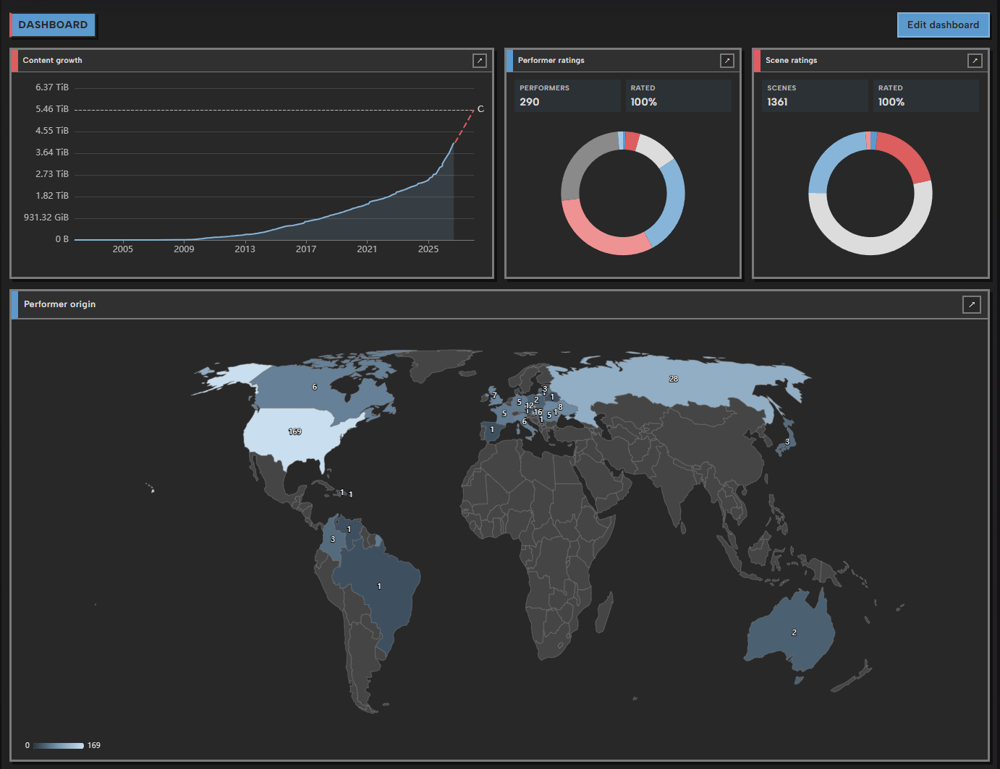

## Included plugins

| Plugin | What it does | Version |
| --- | --- | ---: |
| [DirtyStats](plugins/DirtyStats/) | A customizable dashboard plus full views for origins, growth, ages, ratings, viewing concentration, efficiency, studios, tags, birthdays and cast connections, with native filters and PNG export. | 1.0.14 |
| [DirtyRank](plugins/DirtyRank/) | Ranks performers in gender boxes through category battles using high-precision Glicko-2 ratings, adaptive matchmaking, Gauntlet and King of the hill modes, and leaderboards. | 1.1.1 |
| [DirtyMultiscreen](plugins/DirtyMultiscreen/) | Plays scenes or markers in a configurable, immersive multi-pane grid. | 1.0.25 |
| [DirtyFileExtractor](plugins/DirtyFileExtractor/) | Copies selected scene or image files and extracts selected markers as precisely bounded MP4 clips without changing the originals. | 1.0.6 |
| [DirtyTasks](plugins/DirtyTasks/) | Organizes files, creates additional encoded versions on the same scene, updates tags with independent action triggers, and backs up library data. | 1.0.12 |
| [DirtyCaptions](plugins/DirtyCaptions/) | Displays embedded text subtitles and filters scenes by embedded caption tracks without separate subtitle files or video re-encoding. | 1.0.9 |
| [DirtyPlugins](plugins/DirtyPlugins/) | Required shared runtime, settings hub, suite theme, and database owner. Installed automatically. | 1.0.19 |

## Shared look and settings

Every plugin uses the same rounded controls, aligned selects and actions,
visible focus, and pending/saving/saved/error feedback. Choose one **Suite
theme** in the DirtyPlugins **General** tab: Midnight (the default), Retro
Arcade, Candy Pop, Tropical Punch, Paper Picnic, De Stijl, De Stijl Dark, or
StockStash. It styles all suite-owned surfaces and sets the plugins' navigation
icons; native Stash cards, filters, and players keep the host theme. The same tab creates a backup of the shared database.

A settings button in the Stash header, after every other Dirty plugin button,
opens this page. Turn off **Show settings in the Stash header** in the
**General** tab to hide it.

When Nav Hub is active, the **General** tab also offers **Group Dirty Plugins
in Nav Hub**. Enable it to move visible Dirty Plugins navigation buttons into
the **Plugins** menu. Use **Manage** in that menu to restore individual buttons
to the Stash header. [Nav Hub](https://github.com/xlxil/stash-plugins/tree/main/plugins/NavHub)

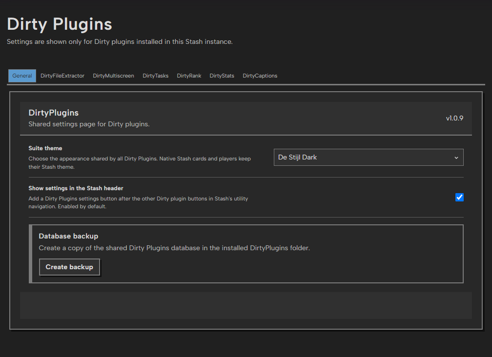

The screenshots in this README use the De Stijl Dark suite theme. Synthetic
review pages for the shared controls are in [`tests/fixtures/`](tests/fixtures/).

## Features

### DirtyStats

- Opens from the bubble chart icon (red, blue, and white circles) in Stash's
  utility navigation.
- A customizable **Dashboard**: add any statistic (more than once if you like),
  drag to reorder, rename, choose Small, Medium, or Large, and give each widget
  its own native scene or performer filters. Layout and options save
  automatically.
- Full views for **Performer origin**, **Content growth**, **Age at scene**,
  **Scene ratings**, **Performer ratings**, **Performer cards**, **Rating vs
  scenes**, **Count vs rating**, **Repeat-offender curve**, **Quality
  efficiency**, **Studio value map**, **Tag DNA**, **Cast constellation**, and
  **Performer birthdays**.
- Reuses Stash's native filter blocks, saved filters, and scene/performer cards.
  Filters run on the server; clicking a chart element narrows the cards below.
- Content growth adds source-volume capacity, a forecast, and period selection.
- Every chart exports as PNG. ECharts and the world map are bundled locally, so
  no metadata leaves the machine.

#### DirtyStats dashboard widgets

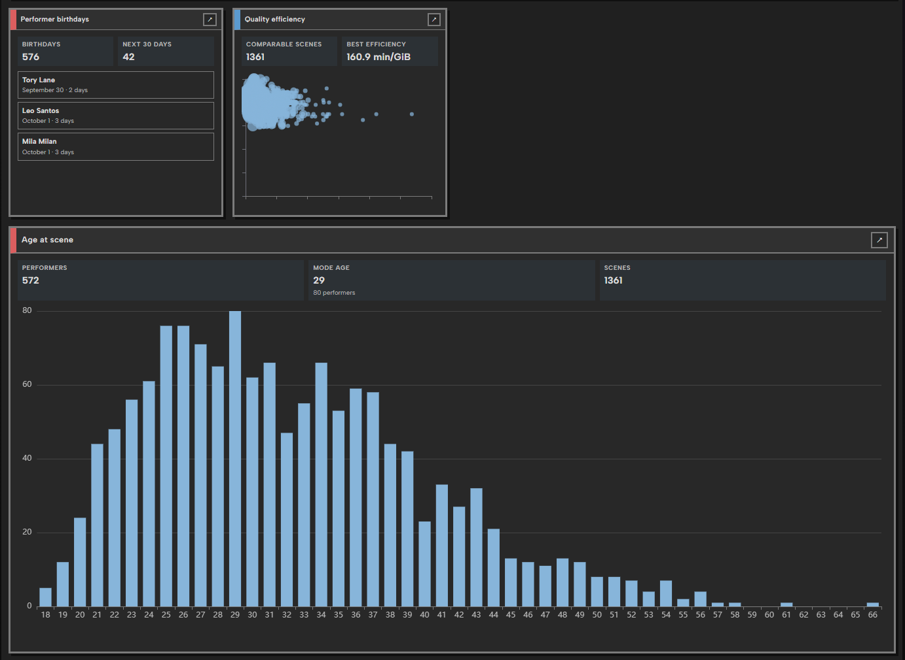

Small and large widgets side by side: upcoming birthdays, quality efficiency,
and the age-at-scene histogram with its summary metrics.

#### DirtyStats full views

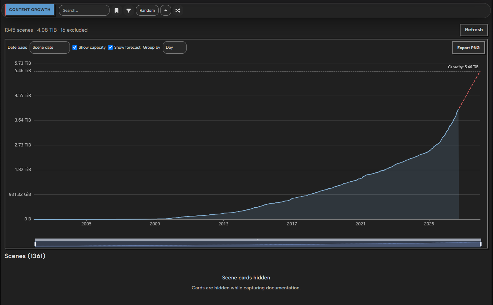

Content growth with the native scene filter bar, capacity line, and forecast.
Scene cards below the chart are replaced by a placeholder in capture mode.

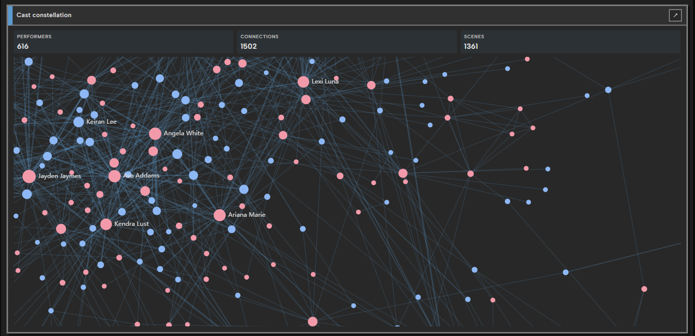

The cast constellation links performers who share scenes; node size follows
scene count and colour follows gender.

#### DirtyStats settings

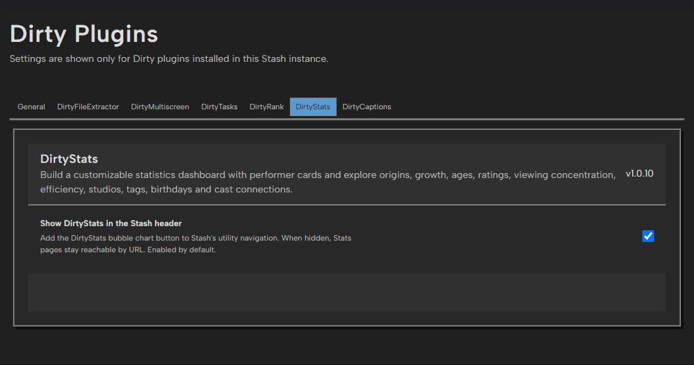

The only setting hides or restores the bubble chart button in the Stash header.

### DirtyRank

- **Gender boxes**: each box selects a group of genders and has its own
  weighted categories and rating pools.
- Glicko-2 rating, deviation, and volatility with full floating-point precision,
  configurable evidence per battle, and four rating presets (Default, Chess,
  Confident, and Extremely confident).
- Expected-information-gain matchmaking towards a selectable confidence goal:
  every rating, complete leaderboard order, or a top N.
- Votes, ties, skips, up to 25 undos, and arrow-key controls. Battles advance
  immediately while persistence runs through an ordered background queue.
- **Gauntlet** mode from any performer page and a **King of the hill** mode
  in which the winner climbs the standings against fresh challengers.
- Optional scene playback below each card, preferring a curated marker and
  falling back to the performer's highest-rated scene.
- Leaderboards per category plus a weighted **Overall** score (Simple weighted,
  Power mean, Rating strength or Proven rating strength), featuring a
  **Podium**, **Mount Rushmore**, or **Fingers** display above gallery or table
  standings. Native performer filters and search
  narrow the results without changing global ranks.
- Adds an **Overall score** option to Stash's performer sort.
- Stores ratings and battle history outside Stash performer fields, avoiding
  performer-update hooks and remaining compatible with Advanced Rating.

#### DirtyRank battles

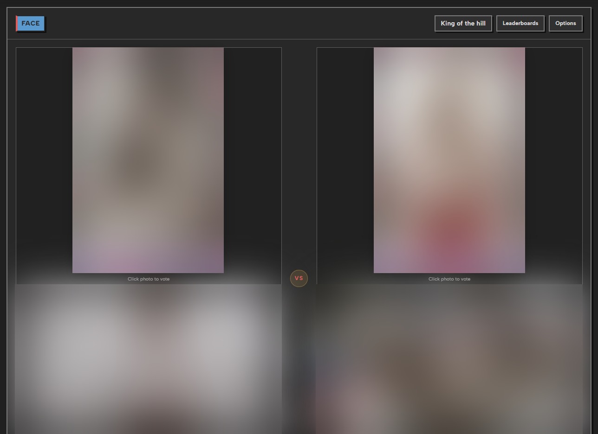

Native performer cards are the vote targets; the previews below them play each
performer's top-rated scene. All media is blurred for the repository.

#### DirtyRank leaderboards

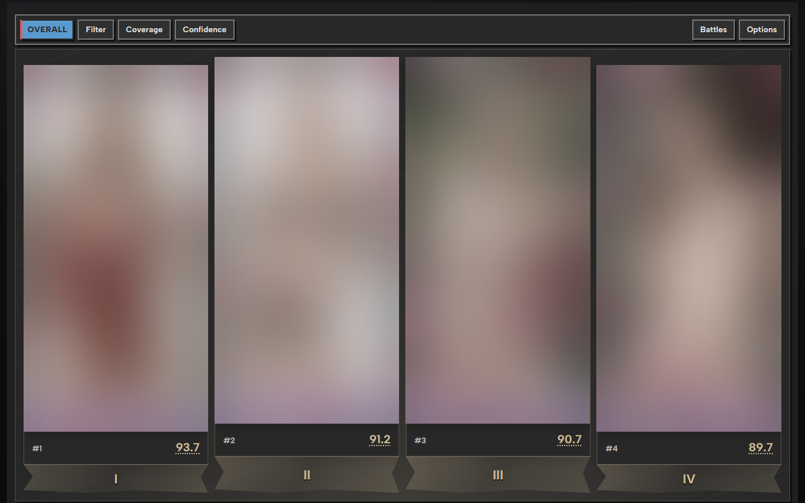

The overall leaderboard with the Mount Rushmore display. Hover a score to see
each category's rank and rating.

#### DirtyRank settings

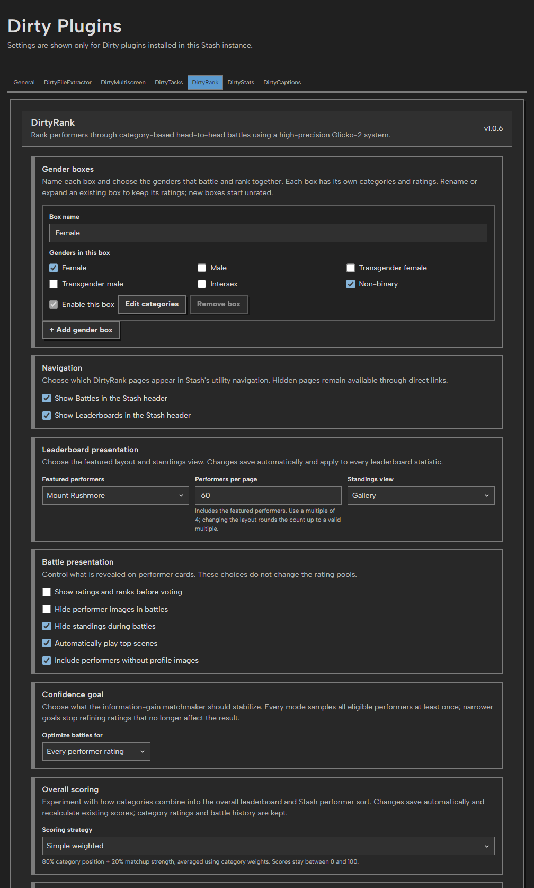

Configure gender boxes, navigation buttons, leaderboard and battle
presentation, the confidence goal, and overall scoring. Categories, their
weights, and advanced Glicko-2 parameters follow further down the same tab.
Every change saves automatically.

### DirtyMultiscreen

- Launches from scene and marker lists, selections, performer, studio and tag
  lists and pages, preserving the active list order.
- Plays the list another plugin's page shows, such as Cherry Pick's For you,
  when that plugin announces it (see [For plugin authors](#for-plugin-authors)).
- Plays a grid of up to 6 x 6 screens. Edit mode chooses the grid, swaps
  screens while they play, and rotates, flips, loops or fills each one. **Fit videos**
  packs screens to match their videos' shapes without restarting playback.
- Saves named grids with every screen's scene, position, sound and picture, and
  opens them again later from any browser.
- Orders scenes at random, with fewer repeats, favouring unwatched, highly
  rated or recently added scenes, as a mix of favourites and unwatched scenes,
  or in the list's own order. Scenes that share a performer or studio are kept
  apart.
- Supports split scene lists, random start points, looping, start-muted
  playback, and pausing while the tab is hidden.
- Plays bounded markers and applies a configurable duration when a marker has
  no end time.
- Each pane has an O-counter button that counts once per playback session.

#### DirtyMultiscreen playback

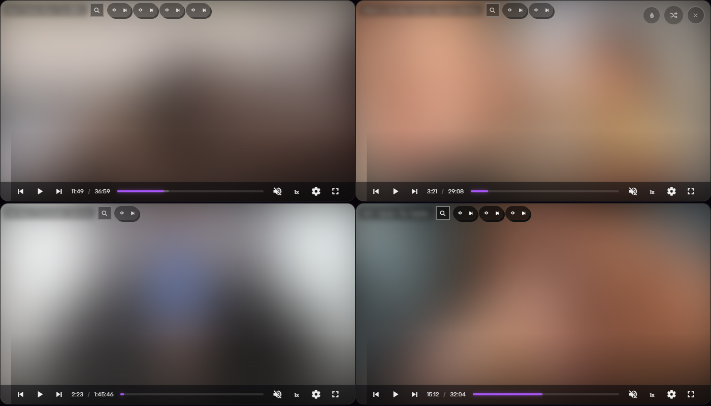

A real edge-to-edge four-pane session with the players paused. Video frames and
titles are blurred for the public repository; the controls, search buttons and
performer buttons stay sharp.

#### DirtyMultiscreen settings

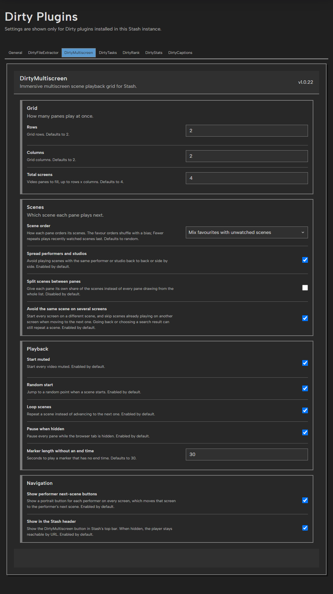

Settings are grouped into Grid, Scenes, Playback, Navigation and Advanced: set
the grid geometry, choose the scene order and how scenes are shared between
panes, how they start, loop, mute and pause, whether screens show performer
next-scene buttons and the grid button appears in the Stash header, and which
other plugins' lists the button plays.

### DirtyFileExtractor

- Adds **Extract selected…** to the selection actions menu for scenes, markers,
  and images, including performer scene tabs.
- Copies original scene and image files without moving or modifying them.
- Uses FFmpeg to extract each marker's exact start/end range as an MP4 clip.
- Supports optional item folders, dry runs, copy-speed limits, and `rename`,
  `skip`, or `overwrite` collision handling.
- Runs as a Stash background task with per-file logs and byte-level progress.
- Includes a server-side folder picker. In Docker, it shows the container
  filesystem, so the destination must be a writable bind-mounted path.

#### DirtyFileExtractor settings

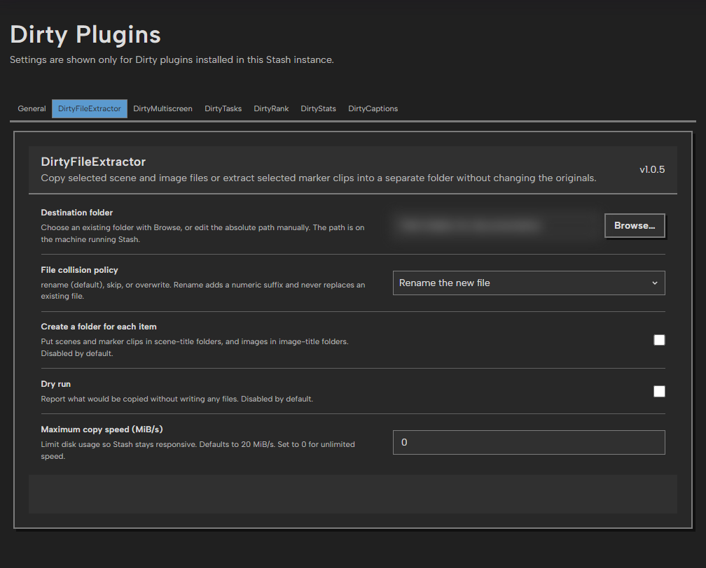

The machine-specific destination path is blurred only in this documentation
capture.

### DirtyTasks

- File organization uses metadata templates for folders and filenames, with an
  immutable preview and explicit confirmation. Multiple versions keep distinct names.
- Ordered **Resize** and **Reencode** rules create additional validated files on
  the same scene. Original files stay on disk and remain primary until you use
  the finished job's actions to make new files primary or delete old files.
- Quality presets, visual-quality measurement, custom bitrate, H.264/H.265 and
  hardware encoding with CPU fallback remain available. Preview and run results
  compare each new file with its original, for example **Created a 40% smaller file**.
- Optional tag updates merge tags from a selected stash-box source after the selected Scan or Generate job,
  with bounded lookups, a one-day successful-check cache and **Refresh tags now**.
- Organization settings save explicitly; encoding rules autosave. Each action and encoding rule selects its own Manual, after Scan or after Generate trigger
  and autosaves that choice. Shared reservations prevent concurrent
  organization and encoding; internal scans never start another automation cycle.
- Encoding runs can be paused and resumed. Cancellation and a small recovery
  journal handle interrupted encoding and attachment. There is no media Delete action or output-review stage.
- Each action can also **Run on a schedule** at a time on chosen weekdays. A schedule missed
  while Stash was closed asks on the next page load whether to run it now.
- **Back up library data** writes one zip with the Stash database and, by choice, blobs,
  `config.yml`, custom CSS/JS/locales, scrapers and DirtyPlugins' database. It has its own
  folder, keeps the newest backups you choose, and runs manually, after Scan/Generate or on a schedule.

[DirtyTasks documentation and upgrade instructions](plugins/DirtyTasks/).

#### DirtyTasks settings

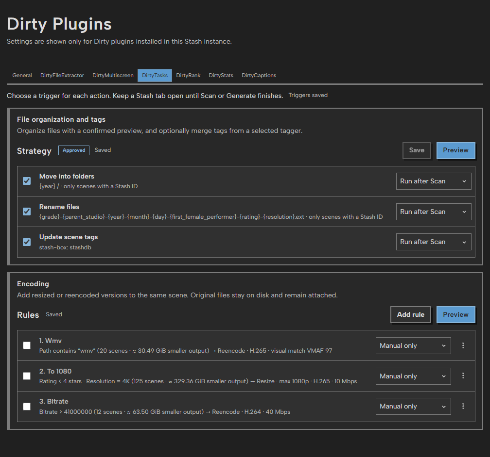

One tab holds the organization strategy with its preview, the tag update, and
the ordered encoding rules. Each row has its own trigger; rule summaries show
the matching scenes and the estimated output size.

### DirtyCaptions

- Displays embedded text subtitles in the native player CC menu, including
  MP4 `mov_text` and embedded SRT/WebVTT.
- Converts subtitle text in memory without separate files or video re-encoding.
- Supports language selection, automatic display, seeking, and native scene
  players in DirtyRank and DirtyMultiscreen.
- ASS/SSA is displayed as ordinary text; bitmap subtitles are unsupported.
- Provides one native **Embedded captions** filter with caption-type and
  index-status choices, automatic metadata indexing, and a manual library
  refresh. An optional setting refreshes the caption index
  after each successful Scan, using the same browser completion events as
  DirtyTasks organization. A persistent file map skips unchanged media; only new or changed
  files are probed, with a separate force-rescan action. Unknown or inaccessible
  files remain unverified.

After installing, reload plugins and hard-refresh the browser (**Ctrl+F5**).
Open a scene and wait for extraction; captions show automatically by default.
The **CC** menu identifies tracks with **embedded** and lets you change language
or turn captions off. Existing external captions remain available. Settings
live in **Dirty Plugins settings → DirtyCaptions**. See the
[DirtyCaptions guide](plugins/DirtyCaptions/README.md) for
setup, supported formats, and troubleshooting.

#### DirtyCaptions settings

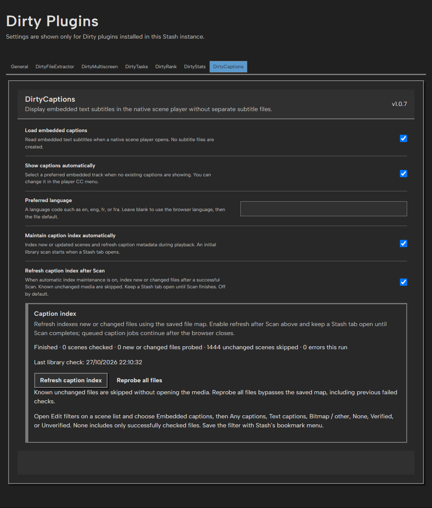

Playback options, automatic index maintenance, and the caption index status
with **Refresh caption index** and **Reprobe all files**.

## Installation from Stash

The recommended installation method is the published package source.

1. Open **Settings → Plugins → Available Plugins** in Stash.
2. Add this package-source URL:

   ```text
   https://dirtyground3.github.io/dirty-plugins/main/index.yml
   ```

3. Reload the available plugin packages.
4. Install any of **DirtyStats**, **DirtyRank**, **DirtyMultiscreen**,
   **DirtyFileExtractor**, **DirtyTasks**, or **DirtyCaptions**.
5. Reload the Stash page after installation or an update.

The source URL must end in `index.yml`; the GitHub repository URL is not a
Stash package source. **DirtyPlugins** is pulled in automatically when a plugin
declares it as a dependency—there is normally no need to install the hub
separately. On its own it adds only a link to the settings page: if that link is
all you see, install one of the plugins above too.

To try changes before they are released, add the release-candidate source
instead and install from it:

```text
https://dirtyground3.github.io/dirty-plugins/prerelease/index.yml
```

Stash updates each plugin from the source it was installed from. Every release
also reaches the release-candidate source, so a candidate moves on to the final
version.

### Initial configuration

Open **Settings → Plugins**, expand an installed Dirty plugin, and select its
link to the shared Dirty Plugins settings page. Each installed plugin has its
own tab there.

- **General:** choose the suite theme and create database backups.
- **DirtyStats:** open the bubble chart icon in the utility navigation and
  choose **Edit dashboard** to arrange your widgets; **Options** beside it opens
  this tab. The tab can hide the icon, with Stats pages staying reachable by URL,
  and can open the dashboard instead of the Stash statistics page.
- **DirtyRank:** set up gender boxes, their categories and weights, and the
  desired confidence goal. The crossed-swords and trophy buttons open Battles
  and Leaderboards.
- **DirtyMultiscreen:** choose the desired pane count and playback defaults.
  Its tab can also hide the grid button from the Stash header.
- **DirtyFileExtractor:** choose an absolute destination directory on the
  machine or container running Stash.
- **DirtyTasks organization:** configure the folder and filename rows, select **Preview**,
  review it, then confirm in **Run…** to save, run, or approve automation.
- **DirtyTasks encoding:** add a rule, choose its scenes, action, and quality
  preset, then **Preview** before the first run.
- **DirtyCaptions:** open a scene and use its native **CC** menu. Set a preferred
  language or turn off automatic caption display in its settings tab.

## Manual installation

1. Download the desired plugin ZIP and `dirtyPlugins.zip` from the package
   source. Contributors can instead run `npm ci` and `npm run build`, then use
   the complete staged directories from `.build/plugins/`.
2. Extract each ZIP into its plugin ID directory (`dirtyPlugins`, `dirtyRank`,
   `dirtyTasks`, etc.) under the Stash plugin directory:

   - Windows: `%USERPROFILE%\.stash\plugins`
   - Linux/macOS: `~/.stash/plugins`
   - Docker: the plugins directory mounted inside the Stash container

3. Keep every package file, including Python helpers and vendor licenses.
   For staged local installs, copy the complete directory's contents into the
   corresponding plugin ID directory. Raw repository source requires a build.
4. In Stash, open **Settings → Plugins** and select **Reload Plugins**.
5. Refresh the Stash browser page.

The Python-backed plugins require Python 3.9 or newer in the environment where
Stash runs; no Python packages are needed. DirtyFileExtractor uses Stash's
configured FFmpeg executable, and DirtyTasks encoding needs Stash 0.31.1 or newer
with FFmpeg and FFprobe.
DirtyCaptions requires Stash 0.31.1 or newer with FFmpeg and ffprobe on the server.

## Updating

Reload the package list from **Available Plugins** and install the offered
updates. Runtime SQLite databases, WAL files, and backups are excluded from
plugin packages, so ordinary package updates do not replace them. Back up the
shared database with **Create backup** in the DirtyPlugins **General** tab
before major manual changes.

## Data and settings

The hidden DirtyPlugins hub owns `dirty_plugins.sqlite3` in its installed plugin
directory. It stores settings for all managed plugins, the DirtyStats dashboard
layout, DirtyRank's rating pools and battle journal, and DirtyTasks encoding's rules,
run snapshots, and recovery journals. The database uses WAL mode for responsive
concurrent reads and writes.

DirtyCaptions stores settings, file fingerprints, and caption-index metadata in
this database. Filterable caption flags are published to scene custom fields.
Embedded subtitle text is read on demand, stays in memory, and is extracted
again when a scene is reopened. No subtitle files are created beside the media.

Standard settings save automatically after a short debounce and serialized
writes prevent an older request from overwriting a newer value. DirtyTasks organization is
the intentional exception: file-moving and renaming strategies require a fresh
preview and confirmation.

## Debugging plugin activity

All Dirty plugins share a browser-side debug log so you can see exactly what
each plugin does on ordinary Stash pages. Console logging is off by default;
when enabled, messages have a `[DirtyPlugins]` prefix. The log is kept in memory at
`window.__dirtyPluginsDebugLog`. Each entry names the plugin, the hook
(`patch.before`, `patch.after`, `patch.instead`, `register.route`, a GraphQL
request, or a lifecycle event), the current path, and elapsed milliseconds.
GraphQL requests and lifecycle events are always recorded. Patch and route
entries, their timing and uncaught page errors are recorded only when debugging
was already enabled while the page loaded, so that normal browsing pays nothing
for them.

Open the browser developer tools (F12) on the Stash tab. To dump the whole
collected log, including entries from
before the console was opened, run:

```js
dirtyPluginsDumpDebugLogs()
```

Enable debugging when troubleshooting, then reload the page (F5) so patches and
routes are timed from the start:

```js
localStorage.setItem("dirtyPluginsDebug", "1"); // persists across reloads
```

To only mirror new entries to the console on the current page, without a reload
and without patch or route timing:

```js
window.__dirtyPluginsDebug = true;              // this page only
```

Filter the console for `DirtyPlugins`. Disable console output again with:

```js
window.__dirtyPluginsDebug = false;             // this page only
localStorage.setItem("dirtyPluginsDebug", "0"); // persists
```

If Stash is stuck on "Loading plugins…", the last `script started` line with no
matching `script finished registering` identifies the plugin whose script never
finished loading. A plugin whose registration throws prints
`[<pluginId>] registration failed` with the error to the console, even when
debugging is off. It is not retried until the page is reloaded, and the other
plugins keep working.

> Stash's **Troubleshooting mode** disables all plugins and custom JavaScript,
> and only raises the *server* log level. Dirty plugin logs therefore do not
> appear while it is active. Exit Troubleshooting mode (which reloads Stash),
> hard-refresh the tab (Ctrl+F5), and check the browser console instead.

### Server-side logs

The Python backends log through Stash's plugin log protocol, so their output
appears in Stash's own log with a `[Plugin / DirtyPlugins]`,
`[Plugin / DirtyRank]`, `[Plugin / DirtyTasks]`, `[Plugin / DirtyStats]`,
`[Plugin / DirtyCaptions]`, or
`[Plugin / DirtyFileExtractor]` prefix.

DirtyPlugins, DirtyRank, DirtyStats and DirtyFileExtractor log a
`backend started: mode=<operation>` line and a
`backend finished: mode=<operation> in <N>ms` line for every call. A `started`
line with no matching `finished` line identifies a backend call that hung.
Every backend logs a failure as an error:
`<Plugin> failed: mode=<operation> after <N>ms: <reason>`.

DirtyTasks and DirtyCaptions are called repeatedly for status or playback, so they do not log each call; they log only failures.
DirtyCaptions reports
extraction failures and failed tracks under `[Plugin / DirtyCaptions]`; the
browser receives only a generic message when a tool error could contain a
private path. Its browser log records player registration and loaded track
counts without including subtitle text.

To see these, keep plugins enabled and set **Settings → General → Log level** to
`Debug` (or at least `Info`), then open **Settings → Logs**. This is separate
from the browser-console log above. Note that Stash does not log the plugin
asset requests themselves; to see whether the server is slow to return a
`/plugin/<id>/javascript` bundle, use the browser's **Network** tab and watch
that request while Stash is stuck on "Loading plugins…".

## Screenshots and content safety

DirtyRank, DirtyMultiscreen, and DirtyStats pages may display adult performer
images, scene titles, or video frames. Any screenshot contributed to this
repository must fully blur, pixelate, or cover every performer image,
thumbnail, video frame, and other potentially explicit media region **before it
is committed**. Cropping alone is not sufficient when another visible region
may contain adult media.

Append `?docsCapture=1` to a suite page to replace native cards, media, and
private paths with placeholders, and inspect every image anyway.
DirtyMultiscreen blurs video frames and scene titles and shows a placeholder
for performer portraits, keeping its controls sharp. Store images
under `docs/images/`, use descriptive filenames and alt text, and keep
uncensored captures outside the repository and its Git history.
On native scene pages, DirtyCaptions capture mode hides the player media,
scrubber thumbnails, and captions; other scene-page images still need review.

## For plugin authors

Another Stash plugin can tell DirtyMultiscreen which scenes or markers its page
shows, so the Multiscreen header button plays that list. Dispatch a
`stash-scenes:context` event on `document` with plain JSON data. Neither plugin
needs the other's code or DirtyPlugins.

| Field | Required | Meaning |
| --- | --- | --- |
| `version` | Yes | `1`. Other versions are ignored. |
| `source` | Yes | Your plugin's ID, for example `cherrypick`. |
| `path` | Yes | The pathname the list belongs to, without the query string. |
| `kind` | Yes | `scenes` or `markers`. |
| `ids` | Yes | Scene or marker IDs in play order. `[]` is an empty list; `null` withdraws yours. |
| `keepOrder` | No | `true` plays the IDs in this order whatever the Scene order setting says. |
| `label` | No | Up to 80 characters, for example `For you`. An empty list says "No scenes in For you". |

```js
const announce = ids =>
  document.dispatchEvent(new CustomEvent("stash-scenes:context", { detail: {
    version: 1, source: "myplugin", path: "/plugins/myplugin",
    kind: "scenes", label: "My list", keepOrder: true, ids,
  } }));
announce(scenes.map(scene => scene.id)); // when the page shows its list, and whenever it changes
announce(null);                          // when the page or its tab goes away
```

- Send the whole list. DirtyMultiscreen keeps the first 10,000 IDs by default
  (its **List size limit** goes from 1,000 to 100,000). A duplicate ID keeps its
  first position. Malformed announcements are dropped and unknown fields are
  ignored.
- Events are not stored. DirtyMultiscreen listens from its plugin setup, before
  Stash shows any page, so announce once your list is ready and again whenever
  it changes.
- **Lists from other plugins** accepts Off, Known plugins only (Cherry Pick, the
  default) or Any plugin. Lists for Stash's own scene, marker, performer, studio
  and tag pages are ignored.
- When two plugins announce a list for one page, the most recent one plays;
  withdrawing it restores the other. A running session keeps the list it
  started with.

## Repository layout

```text
plugins/
├── DirtyCaptions/       # embedded text subtitles via in-memory WebVTT
├── DirtyPlugins/        # shared UI, GraphQL helpers, settings and SQLite owner
├── DirtyFileExtractor/  # selection UI and Python extraction backend
├── DirtyMultiscreen/    # multiscreen playback UI and saved-grids backend
├── DirtyRank/           # battle/leaderboard UI and Glicko-2 backend
├── DirtyStats/          # dashboard, statistics and visualizations
└── DirtyTasks/          # organization, additional encodes and tag updates
tests/                   # JavaScript and Python suites, opt-in Stash fixtures
scripts/                 # staged build, settings generator and plugin registry
schemas/                 # authored settings metadata shared by manifests, TS and Python
.build/plugins/          # generated installable output (ignored)
build_site.sh            # packages staged plugins for GitHub Pages
.github/workflows/       # deploy.yml publishes main and prerelease; release.yml releases prerelease
docs/images/             # censored screenshots used by the documentation
docs/changelog/          # release notes, one <plugin directory>.md per plugin
```

Open work is tracked in [TODO.md](TODO.md); contributor conventions are in
[AGENTS.md](AGENTS.md).

## Development and publishing

Run the test suite from the repository root:

```powershell
npm ci
npm test
```

`npm test` builds once, checks types and formatting, and runs the JavaScript
suites (through `node --test`) and the Python suites. Use `npm run test:js` or
`npm run test:python` for focused runs. Direct Node or Python test-file
invocations need `npm run build` first, and again after changing source:
helpers reject missing staging but cannot detect a stale build. `npm run format`
applies the formatter to TypeScript sources, scripts and JavaScript tests. See
[tests/README.md](tests/README.md) for test paths and fixtures.

Plugin frontends are TypeScript/TSX under each plugin's `src/`, compiled by
esbuild into one browser bundle per plugin with the existing entry filename.
React comes from Stash and is never bundled. Versions before 1.0.0 were
developer builds; their compatibility APIs (such as the HTM `react.html` tag)
were removed. Stats bundles only the ECharts 5.6.0 modules it
uses (pinned npm packages) and its world map data into a separate chart file
that loads when a Stats page opens; no other plugin or the hub loads a chart
library. `npm run typecheck` runs the strict TypeScript check.
Python backends retain their standard-library and same-directory import contract.
Settings shown in Stash (labels, descriptions, defaults, bounds and options) and
constants shared by browser and backend are authored once in `schemas/`; the build
generates the manifest `settings:` section, TypeScript tables and, where a
backend needs them, Python constants such as `dirty_rank_metadata.py`.
A schema may also group its settings under headed `sections` (listing every
setting once, in schema order) and give a setting a `disabledWhen` rule naming
another setting's option or boolean value; the hub renders both for ordinary
settings tabs. A number with a `placeholder` instead of a default may stay empty:
the hub shows the placeholder and removes the stored value, and the plugin
applies its own fallback.

Always use `.build/plugins/<Directory>/` for local installs and packages. Raw
source directories are not installable: they contain no compiled bundle.
Node and development dependencies are needed by contributors only; Stash users
install the same ZIP packages without build tooling. Install files are derived
from each manifest (its script, stylesheets and Python modules) plus the README,
license and the few extra files named in `scripts/plugin-registry.json`; source,
tests, databases, and runtime data are never staged.

Builds retain the previous output in `.build/plugins.previous` until staging
is promoted. A failed promotion restores that output; if restoration is also
blocked, the error names the retained backup and the next build recovers it.
Install paths must stay inside their plugin directory. Package update identities
include the shared source compiled into each bundle, while runtime databases,
bytecode, and backups are excluded from both content and history inputs.

For development:

```powershell
npm run build
npm run build:dev
npm run build:watch
```

`npm run build` stages release bundles without source maps; tests, packages and
local installs use it. `npm run build:dev` and watch stage development bundles
with inline maps, which travel with Stash's aggregated asset because Stash does
not serve individual files. The release size check fails on development
staging, and packaging always rebuilds release output. The development cycle
is: run `npm run build:dev` (or keep
`npm run build:watch` running, which rebuilds staging after any source, schema
or build-input change), copy the changed staged files into the installed plugin
ID directory, reload Stash plugins, then hard-refresh the tab (Ctrl+F5). Watch
mode never touches the installed plugins or refreshes Stash. Stop watch before
running tests or packaging; these commands share staging, and finish with
`npm run build` so release staging is back in place. The opt-in Stash fixtures
check the exact served release bundle; after `npm run build:dev`, their
`--development` option also decodes served map positions back to TSX. Manual
DevTools stepping and other browsers are not covered by automated checks.
Bundles target ES2020; release bundles are minified (no property mangling,
component names and legal comments kept), development bundles stay readable.

Build the package source locally after `npm ci`, on a system with Bash and `zip`:

```bash
./build_site.sh _site/main
```

Packaging rebuilds `.build/plugins/` and writes ZIPs with the manifest at the
archive root. Output cleanup is confined to the repository's `_site/` directory.
Package update identities include both plugin source and shared build inputs.
Generated `.build/` and `_site/` files are ignored and must remain uncommitted.

### Releases

Two branches publish package sources through GitHub Actions:

| Branch | Package source | Versions |
| --- | --- | --- |
| `main` | `https://dirtyground3.github.io/dirty-plugins/main/index.yml` | Releases, `X.Y.Z` |
| `prerelease` | `https://dirtyground3.github.io/dirty-plugins/prerelease/index.yml` | Release candidates: a plugin with unreleased changes is `X.Y.Z-rc` |

Every change reaches `main` through `prerelease`; nobody pushes work to `main`
directly:

1. **Develop** on a branch started from `main`, or from `prerelease` to continue
   an unreleased candidate.
2. **Version** each plugin whose runtime files change with its next version and
   `-rc`: `1.0.23` becomes `1.0.24-rc`. Update the README version table and
   add a release note at the top of the plugin's changelog in
   `docs/changelog/`, both with the final version, `1.0.24`.
3. **Try it locally** if you like, by installing the staged build as described
   above.
4. **Publish the candidate:**

   ```bash
   node scripts/release.mjs check prerelease
   git push origin HEAD:prerelease
   ```

   Add `--force` to the push only to replace a candidate you no longer want.
   GitHub Actions runs the full checks and publishes the prerelease source;
   add that source in Stash to try the candidate.
5. **Approve the release.** The **Release prerelease to main** workflow waits
   for approval in the `release` environment, and GitHub notifies the
   reviewer. Open the waiting run under **Actions** and select **Review
   deployments**. Approving removes `-rc` in a "Release …" commit, moves `main`
   and `prerelease` to it and publishes both sources. Rejecting leaves `main`
   unchanged. A newer push to `prerelease` replaces a release that is still
   waiting.

Each released plugin version also gets a
[GitHub Release](https://github.com/dirtyground3/dirty-plugins/releases),
tagged `<plugin id>-v<version>` (for example `multiscreen-v1.0.25`) on the
release commit. Its text is the entry of the plugin's changelog
(`docs/changelog/<plugin directory>.md`) that names that version, one
`- **Plugin X.Y.Z:**` item with nested items for the details, followed by a
**Full changelog** link to the plugin's previous Release. A note shared by
several plugins goes in each of their changelogs. The changelogs sit outside
the plugin directories, so correcting a note never offers a Stash update, and
the tests require a note for every plugin's current version.
`node scripts/release.mjs github`, run on `main`, creates the Releases that
are missing; the workflow runs it after every release.

`scripts/release.mjs` stops `main` from publishing a `-rc` version, requires
each `-rc` version to be newer than the one on `main`, and requires
`prerelease` to contain every commit on `main`, so a release only moves `main`
forward. If `main` ever gets a commit of its own, merge `main` into your branch
before the next push to `prerelease`.

Stash offers an update when a package's date is newer, not its version number,
and the date is that of the last commit touching the plugin. The release commit
therefore also moves release-candidate installs on to the final version.

The workflow token may not push changes to `.github/workflows`, so the workflow
skips such a candidate with a warning. Release it by hand once it is published:

```bash
git fetch origin
git switch --detach origin/prerelease
git commit --all --message "$(node scripts/release.mjs finalize)"
git push --atomic origin HEAD:main HEAD:prerelease
node scripts/release.mjs github
```

Skip the commit when `finalize` prints nothing.

Each deploy builds its own channel and copies the other one as published,
because GitHub Pages replaces the whole site. The published layout is:

```text
main/
├── index.yml
├── dirtyPlugins.zip
├── dirtyCaptions.zip
├── extractScenes.zip
├── multiscreen.zip
├── dirtyRank.zip
├── dirtyStats.zip
└── dirtyTasks.zip
prerelease/
└── (the same files)
```

## Release notes

Each plugin keeps its release notes, newest first, in its own changelog:

- [DirtyStats](docs/changelog/DirtyStats.md)
- [DirtyRank](docs/changelog/DirtyRank.md)
- [DirtyMultiscreen](docs/changelog/DirtyMultiscreen.md)
- [DirtyFileExtractor](docs/changelog/DirtyFileExtractor.md)
- [DirtyTasks](docs/changelog/DirtyTasks.md), which also holds the notes of
  DirtyTidy and DirtyCompactor, the plugins it replaced
- [DirtyCaptions](docs/changelog/DirtyCaptions.md)
- [DirtyPlugins](docs/changelog/DirtyPlugins.md)

The same notes appear on each plugin version's
[GitHub Release](https://github.com/dirtyground3/dirty-plugins/releases).

## License

This repository and its plugins are distributed under the [MIT License](LICENSE):

- [DirtyPlugins](plugins/DirtyPlugins/LICENSE)
- [DirtyCaptions](plugins/DirtyCaptions/LICENSE)
- [DirtyFileExtractor](plugins/DirtyFileExtractor/LICENSE)
- [DirtyMultiscreen](plugins/DirtyMultiscreen/LICENSE)
- [DirtyRank](plugins/DirtyRank/LICENSE)
- [DirtyStats](plugins/DirtyStats/LICENSE)
- [DirtyTasks](plugins/DirtyTasks/LICENSE)
