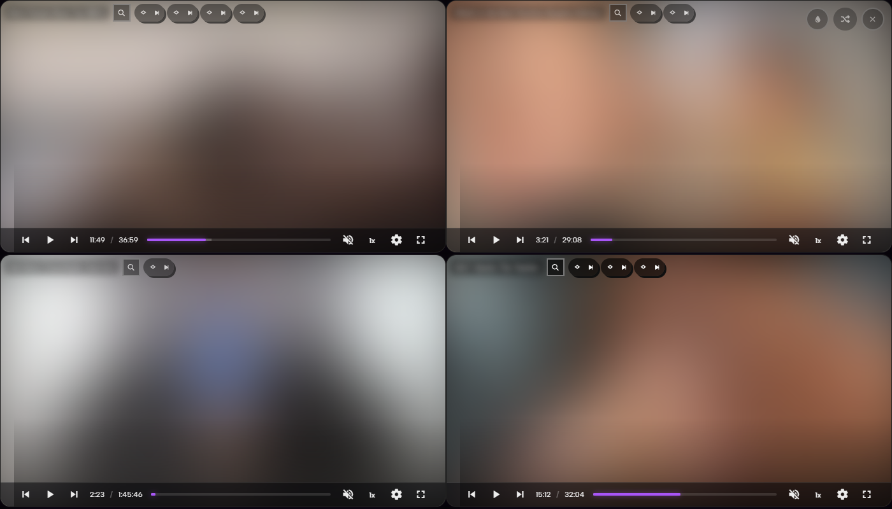
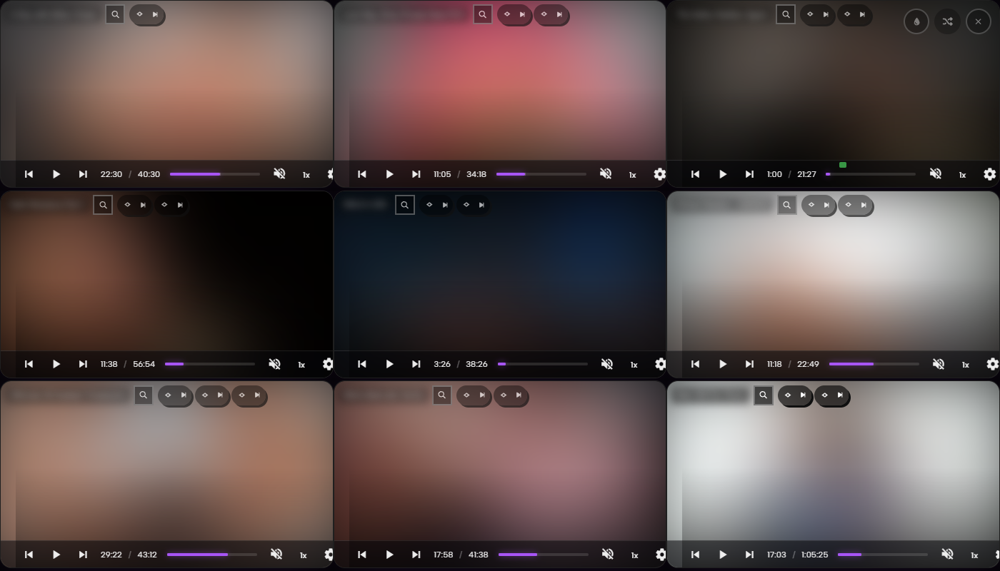
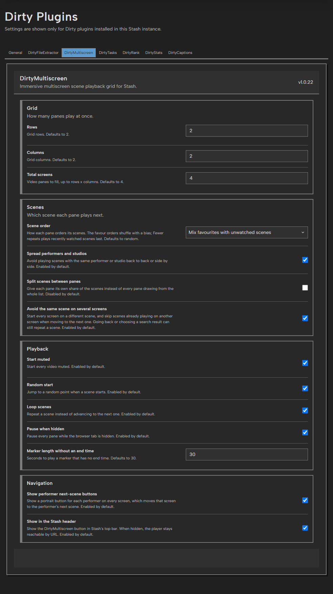

# DirtyMultiscreen

DirtyMultiscreen adds an immersive multiscreen playback grid to Stash. It can launch from Stash scene, marker, performer, studio, and tag contexts while preserving the active list order when appropriate, and from lists other plugins announce, such as Cherry Pick's For you.

## Features

- A grid of up to 6 x 6 screens, chosen in edit mode. Every cell plays.
- Random or ordered scene playback.
- Optional scene splitting across panes.
- Contextual playback continues through independently loaded pages of at most 240 items per pane.
  A pending page is shared between panes, and the current video remains visible if loading fails.
  Explicit selections include items selected on other native pages. Random playback permutes
  each bounded page independently per pane; split assignments remain stable between page requests.
- Another plugin's page can announce the scenes or markers it shows through a
  `stash-scenes:context` event (see [For plugin authors](../../README.md#for-plugin-authors)).
  The header button then counts that list and plays it, in the plugin's own
  order when it asks for one; scenes load 240 at a time, and search and the
  performer buttons stay inside the list. **Lists from other plugins** accepts
  known plugins only (Cherry Pick) by default.
- Random starting positions, looping, and start-muted behavior.
  Each native player has its own identity, keeping durations and streaming
  controls independent between screens.
  Starting positions are applied once the native source is playable, including
  after transcoding fallback, and do not race Stash's saved resume position.
- Marker playback with a configurable fallback duration.
- Optional pause when the browser tab is hidden.
- Seek preview thumbnails are disabled in the grid to keep smaller panes clear.
- The source/settings menu opens to the left of its button so it stays visible in right-hand panes, including with themes that override the native menu width.
- With Refract, every pane uses the same native source menu and its own speed and projection controls. Refract's single-player replacement panel is hidden inside the grid; its ordinary player styling is preserved.
- Search each screen's session with Stash's own search box, saved filters,
  Filter dialog and sort, without interrupting the others. Results stay inside
  the session: selections and lists keep only their own videos, and every
  other session, including one opened without a list, searches its whole
  scope, continues through later queue pages and preserves all launch filters.
  Choosing a result moves that screen to its position in the session queue, so
  Previous/Next follows from there, including across pages.
- The shuffle button below the close button reshuffles every screen. Its menu
  lists the scene orders with the current one checked: choosing it loads a new
  random sample, and choosing another order reshuffles with that order and saves
  it as the **Scene order** setting. A list launched in its plugin's own order
  shows **Keep the list order** checked until you choose another.
- The grid button below the saved-grids button turns edit mode on and off. Videos
  keep playing, and every screen shows seven buttons: move, flip horizontally,
  flip vertically, rotate, loop, fill, and close. A flip mirrors the picture
  only, not the controls or captions, and belongs to its video: it leaves when
  the screen moves to another scene and returns if you go back. Loop and fill stay with the
  screen. Loop starts from the **Loop scenes** setting and overrides it for that
  screen. Fill crops the picture to cover the screen instead of fitting inside
  it, including under themes that force the player to fit, such as Refract.
- Rotate turns the picture 90° clockwise each time: 90°, 180°, 270°, then back
  to normal. It belongs to the video like a flip, keeps playback running, and
  leaves controls and captions upright. At 90° and 270° its width and height
  swap, so **Fit videos** immediately repacks the screens using the turned
  picture's shape. Flips work along the displayed horizontal and vertical axes.
- Drag a screen's move button onto another screen to swap the two: the screen
  shrinks and follows the pointer, still playing, and the screen it would swap
  with is outlined. Or click the move button on one screen and then on another.
  Both keep playing: a screen
  takes its scene, queue, position, audio and picture to its new place. Screens
  are numbered by place, from the top left.
- Drag an edge of a screen that faces another screen to resize it. The grid
  then becomes a custom layout, and the grid size in edit mode reads
  **Custom**. Dragging a side edge past half a screen makes the screen wider
  by that many units of its row; the screens it covers move to the start of
  the next row, which a new row at the bottom holds if there is none. So in a
  2 x 2 grid, widening screen 1 over screen 2 gives one wide screen above
  three, and widening screen 2 over that whole row then moves screens 3 and 4
  to a third row. Dragging back brings screens up again.
- Dragging the bottom edge of a screen at either end of its row down (or its
  top edge up) makes it reach across the next row, whose screens keep that row
  beside it.
  In a 2 x 2 grid, dragging screen 2 down gives it the right half; screen 1
  stays above, with screens 3 and 4 side by side below it. A screen at the top
  or bottom of a column reaches across the next column from its side edge in
  the same way, and dragging back gives the row or column back. Any other edge
  makes its row or column larger. Every screen keeps playing, swapping trades
  places, closed screens return beside their neighbour, and the layout stays
  through reloads and saved grids. Click the current grid's square to get the
  grid back with the same screens playing, or choose another grid to deal
  again.
- With **Fit videos** on, a custom layout keeps where each screen is and each
  video keeps its shape: a row or column you made larger makes its videos
  larger, and a smaller one is centred beside it.
- Close stops a screen and removes it from the grid, so a 2 x 2 grid can play
  three screens. The other screens keep playing and close up in place order,
  and **Fit videos** packs them into the whole window. The last open screen
  cannot close. Closed screens stay closed through reshuffles, reloads and
  saved grids; choosing another grid opens every screen.
- The + button below the grid button adds a screen, in or out of edit mode. It first
  brings back the screen closed last, in its place and with the scene and
  position it had. When every screen is open it grows the grid by a column, or
  by a row once the grid is wider than tall, and opens one new screen at the
  end; the rest of a new row or column waits as closed screens for the next +.
  The playing screens go on undisturbed: the queue is not dealt again, and new
  screens take further lanes of it. The grown grid becomes the default for
  later sessions. At 6 x 6 with every screen open, + is unavailable.
- Edit mode also shows a square for every grid size beside the main buttons.
  Click a square, or press and drag to it, to choose that many columns and rows.
  Another grid deals a new queue, so every screen restarts: a dialog asks first.
  The chosen grid is saved as the default for later sessions.
- **Fit videos**, below the grid size, fits screens to their videos and packs
  them into rows or columns. It is on by default; switching it here also
  changes **Fit screens to videos** in the settings. The picker still chooses
  how many screens play.
  Toggling, swapping and resizing keep the same players running. The layout
  follows each new video's shape, using 16:9 until its size is known. If it
  covers at least 90% of the window, it fills the window with a small crop;
  otherwise the exact shapes form a centred block. Fill is controlled by this
  mode; each screen's own fill choice returns when you switch it off.
- The bookmark button above the grid button opens **Saved grids**. Name the
  current screens to save them: the grid, the closed screens, and every
  screen's place, custom row, scene, position, sound, flip, rotation, loop and fill, plus
  the Fit videos mode. Older saved grids keep your current Fit videos choice.
  A name already in the list replaces that grid after asking, and so does the
  overwrite button on a saved grid, which keeps its name. Click a saved grid to open it in place of the current
  screens; Next then continues through the list it was saved from. Opening a
  grid also makes its rows, columns, scene order, spreading, duplicate avoidance
  and splitting the current settings, because they deal its queue. If a saved
  scene has left the library, that screen starts from its queue instead. Saved
  grids can be renamed and deleted there, and are kept in the shared Dirty
  Plugins database, so they follow you to another browser or device. This needs
  Python 3.9 or newer where Stash runs; the rest of the player works without it.
- **Saved grids** also lists your **Autosaves**, numbered newest first:
  Autosave 1 is the grid you played last. Every launch becomes one, saved at
  most every ten seconds while it plays and at once when you hide the tab or
  close the player. Reloading or opening an autosave goes on updating it; a new
  launch starts another, and the oldest goes once there are more than
  **Autosaves to keep** (5 by default, 0 turns autosave off). The bookmark
  button on an autosave keeps it under a name of your own, as a saved grid that
  is never overwritten automatically.
- Closing the tab keeps the session. Reloading, reopening the plugin page or
  clicking the header button on a page without a list returns every screen to
  its place, scene, position, audio and picture. The header button on a scene, marker, performer,
  studio or tag list, on a performer, studio or tag page, or on a page another
  plugin announced a list for, starts a new session, and so does the shuffle
  button; either replaces the saved one. An announced empty list shows its
  message, such as "No scenes in For you", and keeps the saved session. A tag list or
  page plays the scenes tagged with those tags themselves, not their sub-tags. Changing the scene
  order, spreading, duplicate avoidance, splitting or the number of screens keeps
  the launch scope but deals a new queue. If the library changed, a screen whose
  scene left its page starts at the top of that page. A browser that blocks sound
  in a newly opened tab leaves screens with sound paused until you press play;
  they then continue from their saved position. The browser keeps one saved
  session, in local storage, so two open grids overwrite each other's save and it
  does not follow you to another device.
- Each screen's header has a link icon that opens its scene page in a new tab
  (the scene title is its tooltip), the search button, the performer portraits
  and an O button. They use translucent backgrounds over the video and show and
  hide with the player's control bar, so they fade out on a playing screen you
  are not hovering.
- Each performer has a small round portrait button with a Next badge on its
  corner. Click a portrait to move to another scene featuring that
  performer anywhere in its cast. Tooltips name the performer and explain the
  session scope and wraparound; missing or broken photos use initials.
  Repeated clicks step through that performer's scenes in the session's sort
  and wrap at the end without changing other screens, and Next then continues
  the screen's own queue. Other markers from the current scene are skipped,
  and marker choices retain their original ranges. These
  explicit choices can play a scene already on another screen, like search
  results. Scenes without performers show no portrait buttons; no-match results
  preserve playback with a message that clears after a second. Documentation capture loads no portraits.
  Turn these buttons off with **Show performer next-scene buttons** in the
  Navigation settings.
- A screen's O button adds one O to the scene it is playing, and only that
  scene; each press adds another and briefly shows the new count.
- The O-counter button at the top right, drawn as several drops, adds one O to
  every visible scene and fades away after one click per playback session.
  Failed saves can be retried without incrementing scenes that already succeeded.
- The main buttons stand in a column down from the top-right corner: close,
  shuffle, saved grids, the grid button, +, and the O counter. They show while
  the mouse is near them, and hide three seconds after it moves away, leaves
  the window, or after the player opens; moving the mouse elsewhere does not
  show them. Keyboard focus and an open shuffle menu keep them; a touch shows
  them for three seconds. This holds in edit mode too.
- Runs inside Stash and uses its existing scene and marker data.

## Screenshots

### Playback grid





Real edge-to-edge 2x2 and 3x3 sessions with the players paused. The video frames
are blurred for the public repository; the controls, search buttons and
performer buttons stay sharp.

### Settings



Settings are grouped into Grid, Scenes, Playback, Navigation and Advanced: grid
geometry, scene order and sharing between panes, starting, looping, muting,
marker length and hidden-tab pausing, performer next-scene buttons and the Stash
header button, and lists from other plugins.

## Installation

1. Install the published `multiscreen.zip`, or run `npm ci` and `npm run build` from the repository root and copy `.build/plugins/DirtyMultiscreen/` into Stash's `plugins/multiscreen/` directory.
2. Install the compatible **DirtyPlugins** package, or copy its staged `.build/plugins/DirtyPlugins/` files into `plugins/dirtyPlugins/`.
3. In Stash, open **Settings > Plugins** and select **Reload Plugins**.
4. Expand **DirtyMultiscreen** and follow its settings link.
5. Use the DirtyMultiscreen action in Stash to open the playback grid.

In the grid, click a screen's magnifying glass, search or filter with Stash's
own controls, and choose a result. Search results are paginated, follow the sort
you choose and are limited to the session's playable videos. When the session
was itself launched with a search term, the text you type matches titles, since
Stash keeps one search term per query. During marker playback, results keep the
original marker ranges.

The authored source directory requires a build before installation. Back up
replaced files, copy runtime files before the manifest, reload plugins, then
hard-refresh the Stash browser tab (Ctrl+F5). Preserve settings, databases,
runtime files and Stash's package-provenance `manifest` during a local update.

## Configuration

Rows and columns are chosen in the player's edit mode, not on the settings
page. The DirtyMultiscreen tab of the Dirty Plugins settings has six groups:

- **Grid:** **Fit screens to videos** (enabled by default), the same choice as
  the Fit videos button in edit mode.
- **Scenes:** scene order, **Spread performers and studios**, **Split scenes
  between panes** and **Avoid the same scene on several screens**.
- **Playback:** **Start muted**, **Random start**, **Loop scenes**, **Pause when
  hidden** and the length of markers without an end time.
- **Navigation:** whether screens show performer next-scene buttons, and whether
  the grid button appears in the Stash header.
- **Saved grids:** **Autosaves to keep**, from 0 to 10 (5 by default).
- **Advanced:** **Lists from other plugins** (Off, Known plugins only, the
  default, or Any plugin) and **List size limit**, the most items taken from one
  plugin's list (10,000 by default, from 1,000 to 100,000).

Spreading, avoiding duplicates, muting, random starts, looping and pausing are
enabled by default.

**Avoid the same scene on several screens** applies when scenes are not split
between panes, since split panes never share a scene. Every screen starts on a
different scene, and a screen moving to its next scene skips scenes that another
screen is playing. Going back with Previous never skips, and a search result
always plays, so you can still put the same scene on several screens. With
fewer playable scenes than screens, screens repeat a scene rather than stay
empty, and when every other scene is already on a screen, Next moves to the
next scene in the list anyway.

### Scene order

Each pane gets its own playback list. **Scene order** decides how it is built:

| Order | How it works |
| --- | --- |
| Random (default) | A uniform shuffle of the session's scenes. |
| Fewer repeats | Like Spotify's Fewer Repeats shuffle: draws up to 16 shuffles and keeps the one that plays recently watched scenes last. A play counts half as much after each week. |
| Favour unwatched scenes | A weighted shuffle. A scene played once comes early 8 times less often than an unwatched one, twice 27 times less often. |
| Favour high ratings and O counts | A weighted shuffle. Every 20 rating points multiply the weight by about 2.7, unrated scenes count as 50, and each O count adds the base weight once more. |
| Favour recently added scenes | Loads the newest scenes first, then shuffles them with a weight that halves every 30 days since a scene was added. |
| Mix favourites with unwatched scenes | Like a smart shuffle: two scenes from the favourites order, then one from the unwatched order, never repeating a scene. |
| Keep the list order | The launching list's own sort, or title order when launched without a list. |

Every order except Favour recently added scenes and Keep the list order loads
the launching list (or the whole library) in a random order, one page at a time,
and weights each page as it arrives; playback continues through every page. Weighted shuffles use the Efraimidis-Spirakis
method: a scene with weight w leads w times as often as a scene with weight 1.

**Spread performers and studios** keeps scenes that share a performer or studio
apart. Random and Fewer repeats use Spotify's original artist spreading: each
performer's scenes (or a studio's, for scenes without performers) are placed at
evenly spaced positions with a random start
and up to 20% jitter. The weighted orders keep their priority but pull forward
the nearest scene that shares nothing with the previous one, or with the scenes
the other panes play alongside it when **Split scenes between panes** is on.

**Show in the Stash header** (enabled by default) hides or
restores the grid button without a reload. While it is hidden, the button
counts no scenes and the player stays reachable at `/plugins/multiscreen`.

## Source

Strict TypeScript domains and services live under `src/`; focused TSX components
use Stash's React instance and the DirtyPlugins public API. The build stages one
browser IIFE, `multiscreen.js`, as the manifest's sole frontend script. Release
builds carry no source map; `npm run build:dev` adds an inline map that travels
with `/plugin/multiscreen/javascript`. No React or hub
implementation is bundled into this plugin.

The entry registers its route, patches and `stash-scenes:context` listener once
through the hub's `registerPlugin`. A reloaded bundle is ignored, including after a partial
native registration failure, which is logged once. Unmounting components clear
their timers, listeners and observers, ignore late responses and release the
native players.
Saved grids are the only server-side part: `dirty_multiscreen.py` answers the
browser through the shared protocol and `dirty_multiscreen_grids.py` owns the
`dirty_multiscreen_grids` table in the shared database, where a `recent` flag
marks the autosaves. A grid's session is stored as the JSON
text the browser sent. The row limits come from the generated
`dirty_multiscreen_metadata.py`.
Domain tests compile modules on demand; UI tests execute the final browser bundle;
`tests/test_dirty_multiscreen_grids.py` covers the table and the protocol.
An opt-in isolated Stash fixture uses synthetic media only:

```powershell
npm run build
python -B tests/test_dirty_multiscreen_stash_integration.py --binary /path/to/stash --serve --stop-file .build/multiscreen-review-stop
```

Add `--transcode` to use synthetic FFV1 files and exercise native source fallback
and full-scene time offsets during browser review.

Close the review tab and create the named stop file to remove the temporary
fixture. The remaining browser/manual limits are listed in the repository's
`TODO.md`.

The UI consumes DirtyPlugins' shared GraphQL client, value helpers, React
icon/state components, and visual tokens so its controls remain consistent with
the other plugins in this repository.
The navigation action is one focusable link, and overlay controls become fully
visible on keyboard focus. Native ScenePlayer remains the playback component.
With `?docsCapture=1`, video frames and posters are blurred,
captions are hidden and performer portraits show a placeholder, while the player
controls stay sharp.

## License

DirtyMultiscreen is distributed under the [MIT License](LICENSE).
