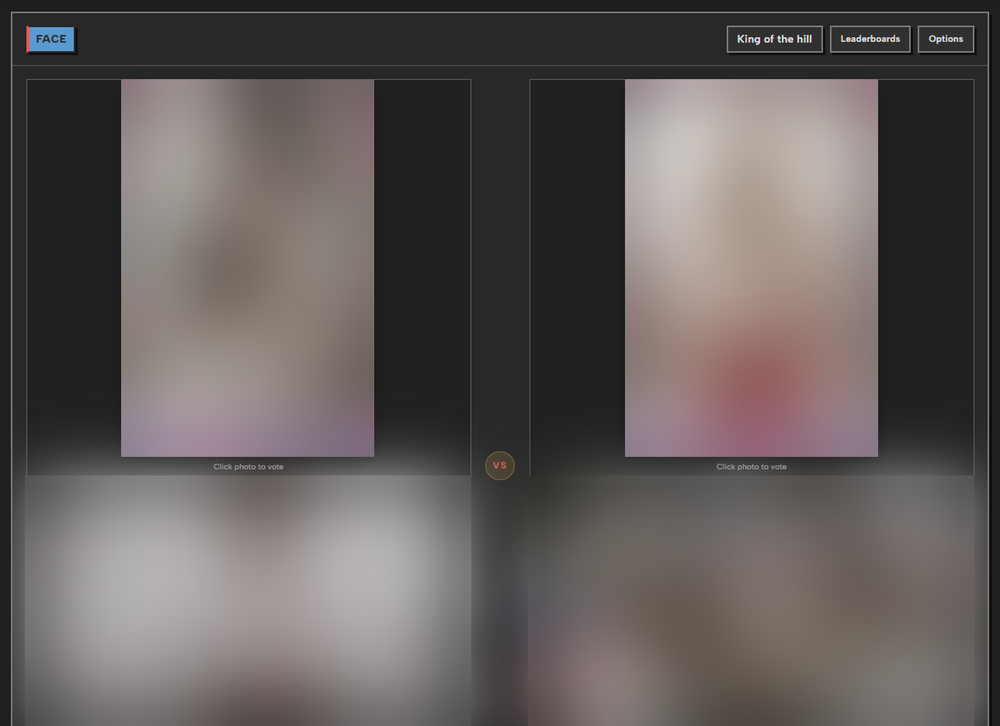
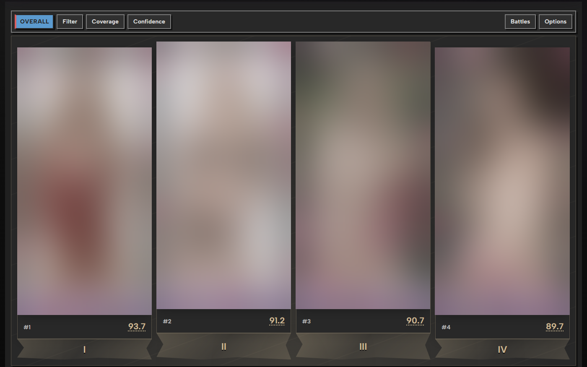
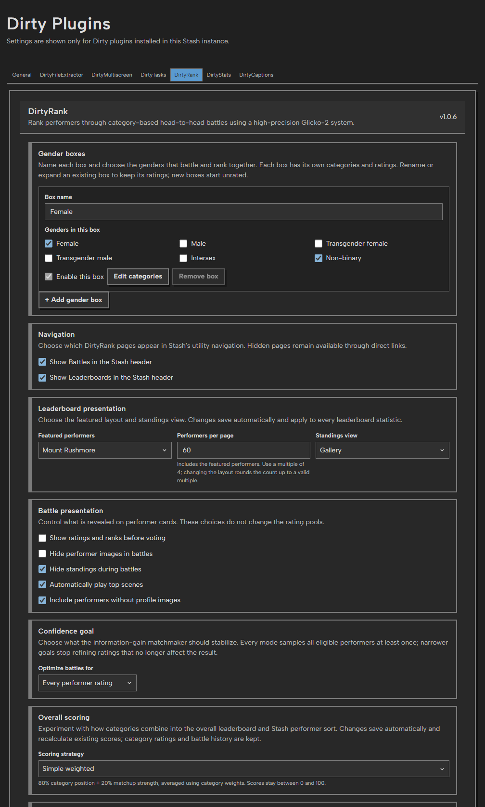

# DirtyRank

DirtyRank ranks Stash performers through head-to-head battles. Each battle
asks for one verdict on a seven-step scale, and each pair keeps one saved
verdict. Every category and gender box fits a rating and a rating deviation (RD)
for each performer to all of its verdicts at once, instead of relying on a
capped integer score.

## Features

- Standings gallery and podium use Stash's native performer cards, so installed
  themes and performer-card customizations apply automatically. DirtyRank scores
  and ranks appear separately below the cards; the cards keep their Stash ratings.
- Overall leaderboards and native overall sorting prepare complete scores before
  showing standings. Large calculations let the interface respond between batches;
  verdicts update prepared comparison sums immediately. The rating formula stays the same.
- Battle, leaderboard, and settings controls use the shared DirtyPlugins style
  primitives. Native performer cards and the native scene player keep their Stash
  styling and behaviour as themes change.
- Battles and Gauntlet also use native cards. Their photos, buttons and profile
  links keep their normal actions; a verdict is given only with the numbered
  scale. Scene players remain separate below the cards. Hiding performer images
  also hides the native card.

- Named **gender boxes**, each with a selectable group of genders and its own
  categories. For example, create Box 1 for Female + Non-binary, Box 2 for Male,
  and Box 3 for Transgender female + Transgender male. A **Gender box** selector
  on battles and leaderboards switches the entire participant and category set.
  Gauntlet offers only boxes that include its target. URLs preserve box selection.
- The battle page remembers the explicitly selected category for each box,
  including across page reloads, and changes it only if that category is
  disabled or removed.
- Existing per-sex groups become boxes with the same storage IDs, categories,
  ratings, and history. Rename them and change their genders in **Gender boxes**,
  or add new boxes. New boxes and members new to a pool start unrated; ratings
  from other boxes are independent and are not automatically merged. Removing a
  gender or disabling a box hides its performers without deleting their ratings.
  Select the gender or enable the box again to restore their standings.
- Every box starts with Appearance and Performance categories.
  Category IDs and bookmarkable leaderboard URLs follow the category label;
  matching sanitized labels receive `-1`, `-2`, and so on. Renaming a category
  keeps its ratings and verdicts.
  Categories have a weight. Choose **Simple weighted** (the original calculation),
  **Power mean**, **Rating strength** or **Proven rating strength** in settings.
  Every strategy uses only enabled categories that include the performer's
  gender. Category ratings and verdicts stay unchanged.
- High-precision ratings with no normal upper ceiling; the default starting
  rating is 1000.
- Each battle asks for one verdict on a seven-step scale above the cards:
  **3 2 1** for the left performer (much better, better, slightly better), **0**
  for equal, and **1 2 3** for the right performer. A diverging colour gradient
  deepens toward each performer's 3, teal on the left and rose on the right,
  with a neutral 0. Click a number, or press the home-row keys **A S D** for
  the left performer's 3 2 1, **G** for equal and **J K L** for the right
  performer's 1 2 3. The keys work by position, so every layout uses the same
  spots: on AZERTY they are Q S D · G · J K L. The keypad works too, giving the
  strength directly: **1 2 3** for the left performer, **0** for equal and
  **4 5 6** for the right performer (4 is slightly, 6 much better), with Num
  Lock on or off. Chrome and Edge report the
  keyboard's own letters for the hint under the scale; other browsers show the
  QWERTY letters. **Undo** sits at the far left of the same row; ↓ or **U**
  does the same. The next pair
  appears at once, while the number you chose flashes briefly on the scale. A
  performer who stays for the next battle keeps their side. There is no tie or
  skip button: when you cannot tell them apart, 0 is the verdict.
- A pair keeps one verdict. When a judged pair comes back, its saved verdict is
  highlighted: choose the same number to keep it (a confirmation), or another
  number to replace it.
- Ratings are refitted to every verdict after each choice, so a verdict over a
  newcomer gains value once that newcomer proves strong, and undo restores the
  pair's earlier verdict exactly. The fit counts each verdict once by default
  (**Evidence per verdict**); lower it if your verdicts often change.
- Provisional ratings based on rating deviation. Inactivity does not alter a
  performer's rating or uncertainty.
- Battles come in order of the Shannon information their verdict is expected
  to add to the ratings that matter for the selected confidence goal. New
  performers also meet each other, since the refit places both, so battles
  spread across the category instead of returning to a few settled
  performers. A judged pair competes too, but only comes back when the other
  verdicts point to a slip (see **Rating model**).
- Selectable confidence goals for every performer rating, complete leaderboard
  order, or a configurable top N. Leaderboard modes stop refining performers
  once they no longer affect the requested ordering.
- Each battle card can load media on demand. It prefers a curated marker from
  the performer's highest-rated scene that has markers, then falls back to the
  performer's highest-rated full Stash scene.
- Enable **Automatically play top scenes** on the **Battles** settings tab to
  open each performer's highest-rated full scene when a battle starts, including
  Gauntlet battles. This setting is off by default; when off, media is requested
  only when the play button is used.
- Full scenes start at a fresh random point between 30% and 70% of their duration.
  Curated markers retain their original start/end bounds. Previews start muted;
  use the player controls to enable sound or resume if the browser blocks playback.
- Previews appear in separate panels below the photos. Photos stay visible
  unless hidden in settings, and each preview can be closed independently.
- With DirtyMultiscreen installed, open one or both battle previews, then use
  its Stash header button to play their scenes from left to right. A marker
  preview supplies its full scene to the grid.
- Converted streams use Stash's native scene player for the full duration and
  seeking throughout the scene, including formats such as WMV.
- Automatic previews wait briefly for a battle to settle before loading. Leaving
  a battle or closing a preview cancels its metadata request and releases its
  video stream, so rapid choices do not leave old downloads running.
- Performer images can be hidden from battle cards without changing which
  performers are eligible for the pool.
- Performer names on battle cards open their Stash performer pages. Every new
  battle animates the cards and fades images in after loading, even when a
  performer or image repeats, so the change remains unambiguous. In Gauntlet,
  the left target card stays in place across verdicts and undo, keeping its
  current video playing while only the right challenger card refreshes.
- Performer profiles show category rank buttons beside **Start Gauntlet**.
  Each button displays the current leaderboard position and opens that category
  in the matching gender box. Only enabled categories with a leaderboard rank
  appear; ranks in multiple boxes include the box name.
- DirtyRank prepares the next pair during browser idle time and preloads both
  profile images, so verdicts advance immediately while preserving the full
  matchmaking search.
- **Gauntlet** mode focuses every battle on one performer and chooses the
  opponent whose verdict tells the most about that performer's current
  category rating, preferring settled opponents because only the target keeps
  battling. Launch it with **Start Gauntlet** on any Stash performer
  page. Its target confidence bar shows progress toward Refined and Excellent
  rating precision, with an estimate of the remaining battles.
- Battles advance immediately while verdicts are persisted through an ordered
  background queue; pending writes and failures remain visible in the UI.
- While verdicts or undos remain queued, DirtyRank blocks in-app navigation and
  asks for confirmation before browser reload, tab close, or window close. The
  guard disappears automatically when all background operations finish.
- The last verdict stays visible in words while the next pair is already
  available, with the favoured performer in green, the other in red, and both
  in amber for an equal verdict.
- Standard battle headers keep only the DirtyRank title and controls; Gauntlet
  retains its target confidence bar. Category confidence details remain
  available on the Leaderboards page.
- **Hide standings during battles** on the Battles settings tab hides the right-hand
  standings and widens standard and Gauntlet battles. Changes save automatically.
- Standard battles show how many eligible performers in the selected
  category and sex still need refinement, with an estimate to refine the whole
  cohort. The estimate assumes informative matchups and hides when all eligible
  performers are Refined or Excellent; it is independent of the matchmaking goal.
- Each battle category has a bookmarkable URL: `/plugins/dirty-rank/category/<id>`.
  The category picker updates the URL; reloading or browser Back restores that
  category. Gauntlet categories use
  `/plugins/dirty-rank/gauntlet/<performerId>/<categoryId>`. The original Battles
  and Gauntlet links open the remembered category and redirect to its URL.
- A dedicated **Leaderboards** page covers every gender box, each enabled
  category, and the weighted overall score. Choose **Podium** (the default
  gold/silver/bronze steps), **Mount Rushmore**, or **Fingers** to feature your
  leading performers. Choose this and the Gallery or Table standings view once
  on DirtyRank's Leaderboards settings tab; both save automatically.
  **Performers per page** includes the featured top and the standings underneath,
  in either view. Use a multiple of 3 for Podium, 4 for Mount Rushmore, or 5 for
  Fingers, with a minimum of two rows. Changing the layout rounds the count up
  to a valid multiple (up to 1000). The default is 18, adjusted for the layout.
  Gallery columns match the selected layout on wide screens, with tight gaps
  and padding to give each performer card more room. Filters hide the
  featured top and use the full performer count for their results.
  Coverage and Confidence open compact toolbar popovers without adding rows
  or moving the standings. Each statistic has its own bookmarkable leaderboard URL. Stash's native
  performer filters narrow the displayed results while ratings, summary
  statistics, and rank numbers remain global. Hover an Overall score in the
  featured cards, gallery, or table to see each category's leaderboard position
  followed by its rating in parentheses, and rated-category coverage. Mount Rushmore
  keeps its carved-stone bases; Fingers arranges its numbered columns as
  **1–2–3–4–5**, with each successive column slightly shorter. Mount Rushmore
  and Fingers stretch their portraits taller to fill the extra room. Cards show
  rank and score on one line, with no score label or `/100` suffix. An asterisk
  marks results that still need comparisons; refined and excellent results have
  no marker. While ratings are uncertain, each rank also shows its likely
  positions, for example **#5 3–9**: two rivals are clearly ahead (at least 90%
  likely to be better) and six more are too close to call. The ranges agree with
  each other: when a leader could drop, the rivals close behind can reach first.
  The Overall leaderboard carries each category's uncertainty through the
  selected scoring strategy. Gallery and table standings have no decorative panel
  headers.
  Win/loss records are hidden. Smaller screens show the Fingers cards in rank order;
  the remaining gallery or table starts at the next rank. Search finds any rated
  performer by name, including those featured above, and keeps their overall
  rank in the results. Full standings,
  confidence, rated coverage, stable-rating coverage, completed battles, median
  RD, share of equal verdicts, and rating spread are also included.
- Separate **Show Battles in the Stash header** and **Show Leaderboards in the
  Stash header** switches control the two utility navigation buttons. Both are
  enabled by default and save automatically; hidden pages remain accessible by
  direct link.
- Up to 25 consecutive session undos, home-row keys for the scale, ↓ or U for
  undo, responsive performer cards, and a weighted overall leaderboard. Undo
  restores the previous pair immediately and queues its database reversal
  behind pending verdicts; repeated Undo presses
  synchronously consume the history in LIFO order. The button reports the
  remaining depth.
- An **Overall score** option in Stash's performer sort menu. It respects the
  current performer filters and page size, supports both directions, calculates
  each performer's weighted score from the default box when eligible, otherwise
  the first eligible enabled box, and
  keeps performers without a DirtyRank result at the end.
- A **Reset ratings** button on each category in settings, under the category's
  **Description, reset and remove** details. Its confirmation names
  the gender box and category; resetting clears only that pool's ratings and
  verdicts. Reset buttons wait for pending settings to finish saving.
  Full database backups are available in shared Dirty Plugins settings.

## Overall scoring

Choose **Settings → DirtyRank → Categories → Overall score → Scoring strategy** to
experiment. Switching strategies or adjusting their parameters automatically
recalculates the Overall leaderboard and Stash's Overall score performer sort.
It does not change category ratings, verdicts, or matchmaking.

| Strategy | Calculation | Defaults | Range |
| --- | --- | --- | --- |
| Simple weighted | Weighted average of 0.8 × position + 0.2 × strength | Original behavior | 0–100 |
| Power mean | (weighted average of category scores raised to p) raised to 1/p | Power 3; adjustable from 1 to 4 | 0–100 |
| Rating strength | Weighted average of (rating − category mean) / category standard deviation | — | Unbounded; 0 is average |
| Proven rating strength | Weighted average of (rating − RD − category mean) / category standard deviation | — | Unbounded; 0 is average |

Hover an overall score to see the strategy, category ranks, and category scores.

The percentile strategies (Simple weighted and Power mean) reward performers
who are good in every category: a top-30 place costs only a few points against
first place, while one weak category costs many. The rating strategies keep
the real rating gaps instead, so a category where a performer is far ahead of
everyone counts in full. Proven rating strength also subtracts each category's
rating deviation, so a performer with few verdicts ranks lower until more
verdicts confirm the rating. Unrated categories use the initial rating and RD, which is
about average for Rating strength and below average for Proven rating strength.
Rating strategies show scores with two decimals.

Power mean changes only how the category scores are combined. Power 1
matches Simple weighted exactly; power 2 mildly emphasizes strengths; power 3
is the suggested starting point; power 4 emphasizes them more. Decimal powers
are supported. All enabled categories retain their weights, and missing
categories contribute 50. A single category retains its original score.

For both percentile strategies, compare the performer with all other rated performers
in the same performer-sex cohort. Percentile position awards 100 to first place
and 0 to last place, with ties sharing their average position. Matchup strength
is the average rating-only expected score against those same performers:
`1 / (1 + exp((opponentRating - rating) / 173.7178))`, multiplied by 100. This
uses rating differences, counts draws as half, and deliberately keeps rating
deviation separate as a confidence measure.

The category contribution is `0.8 * position + 0.2 * strength`. Overall score
with Simple weighted is the weighted average of these contributions. A larger
rating advantage increases matchup strength towards its ceiling, so a category with extreme
ratings cannot gain unlimited influence. At the same percentile position,
strength can change the category contribution by at most 20 points before
applying its overall weight.

An unrated category contributes a neutral 50 and keeps the overall result
provisional. A category with only one rated performer also contributes 50
because there are no opponents for comparison. Fully tied pools score 50.
Performers with no rated categories remain outside the overall leaderboard
and at the end of the native performer sort in either direction.

Normalization uses the full cohort, including rated performers without images;
page filters and pagination only change what is displayed. Deleted performers
and rating pools left over from another gender box are excluded when the
performer list is refreshed. Scores are cached and recalculated after rating,
undo, reset, or reference-population updates. The displayed score uses one
decimal place, while ordering uses full precision. Overall precision and RD
describe the underlying category ratings; the likely positions on the Overall
leaderboard come from how far the score moves when each category rating moves
by its RD.

## Screenshots

For safe documentation views, append `?docsCapture=1` to either DirtyRank page.
Capture mode hides media, including media inside native Stash cards and
players; inspect any image before adding it to repository documentation.

### Performer battles

A standard battle with **Hide standings during battles** and **Automatically
play top scenes** enabled: each top scene plays in its own panel below the
native performer cards. Photos and video are blurred for the repository. This
screenshot predates the verdict scale, which now sits above the cards in place
of the Tie and Skip buttons below them.

### Leaderboards

The Overall leaderboard with the Mount Rushmore display. Filter, Coverage, and
Confidence stay in the toolbar; the gallery or table standings continue below.

### Settings

DirtyRank settings are split into tabs in the shared hub, and DirtyRank
remembers the last one you opened:

- **Categories:** each category on one row with an on/off switch, name,
  weight and its share of the overall score. Description, **Reset ratings**
  and **Remove category** sit under the row's details. **Overall score**
  chooses the scoring strategy.
- **Battles:** what battle cards reveal, the header button, and the
  confidence goal that orders battles.
- **Leaderboards:** featured layout, page size, standings view and the header
  button.
- **Gender boxes:** box names, their genders and the default box.
- **Advanced:** rating model parameters, each with a short explanation.

## Data and compatibility

DirtyRank stores its high-precision pools and verdicts in the shared
`dirty_plugins.sqlite3` database owned by DirtyPlugins. It does not change
performer custom fields or Stash's native `rating100`, so saving a verdict does
not trigger performer-update hooks and it can run alongside Advanced Rating.

Each pool stores its unrounded rating, deviation, result counts, and latest
verdict time, and each category stores where its "slightly", "better" and "much
better" begin. Each pair keeps one verdict, from -3 to 3, with how often it was
confirmed. Every choice is also logged in order with what it replaced, for
duplicate protection and undo; undo restores the pair's earlier verdict, or
removes a new one, and refits. Resetting a pool clears its ratings and verdicts.
The database uses WAL mode, and the Options backup action safely snapshots all
Dirty-plugin tables.

Verdicts replace the earlier win, tie and loss battles. On first use after an
upgrade, DirtyRank backs up the whole shared database next to it
(`dirty_plugins-backup-<time>-<id>.sqlite3`), which keeps every earlier battle
and rating, and then starts every pool unrated. It also removes settings that
belonged to earlier rating models and matchmaking (Glicko-2 volatility and tau,
recent pairs to avoid and calibration matches) and resets the evidence and
starting deviation tuned for them.

## Installation

Install DirtyRank from the Dirty Plugins package source, or copy both the
`DirtyRank` and sibling `DirtyPlugins` directories into the Stash plugins
directory and reload plugins.

Open **Settings → Plugins → DirtyRank → Open Dirty Plugins settings** to choose
the default gender box and configure categories. Under **Gender boxes**, name
each box and use **Genders in this box** to choose its participants. Use
**Edit categories** to define that box's categories. Changes save automatically.
Launch battles with the
crossed-swords button in Stash's utility navigation, then use **Leaderboards**
on the battle page to inspect every category set.

## Rating model

DirtyRank fits each category and gender box as an ordinal Bradley–Terry model.
Your perception of two performers is their rating difference plus logistic
noise, with a 400-point gap meaning 10:1 odds, and a verdict says where that
perception fell: between -"slightly" and +"slightly" is equal, beyond
"slightly" is 1, beyond "better" is 2, beyond "much better" is 3. The three
thresholds mirror around equal and are learned per category from your own
verdicts, starting from 0.6, 1.8 and 3.2 log-odds, so the model adapts to how
you use the scale. Every performer starts from a normal prior at the **Initial
rating** with the **Initial deviation**, and each verdict counts **Evidence per
verdict** times. The stored rating is the most likely value given every
verdict, and its RD comes from how sharply the likelihood falls around it,
never below the **Deviation floor**. Because all verdicts are fitted at once,
their order does not matter, later verdicts revalue earlier ones, and changing
these values applies to all past verdicts immediately.

Battles are ordered by information. For every possible pair, DirtyRank predicts
how likely each of the seven verdicts is and how far each would move the two
ratings; the expected divergence is the Shannon information (mutual
information) the verdict adds. Performers that matter for the confidence goal
weigh more, so the next battle is the pair whose verdict is expected to teach
the most about the standings you asked for. Close, uncertain performers rank
highest. An opponent's own uncertainty does not lower a battle's value:
every verdict is refitted together, so a battle between two uncertain
performers places both of them as the fit learns more about either.

A judged pair competes too. Its answer would replace the saved verdict, and
choosing the same verdict changes nothing, so it only gains when the saved
verdict was probably a slip. DirtyRank asks how likely the saved verdict is
given every other verdict, compares that with how likely it is with no
evidence at all, and assumes one answer in ten can be a slip that lands on any
number. A verdict that fits the others, or one nothing else can check yet, such
as a newcomer's only verdict, effectively never returns; a verdict that breaks
a clear chain, such as A above B, B above C, but C much better than A, can come
first. Each confirmation makes a slip much less likely, so a loop you confirm
stays as you gave it, and the fit finds the ratings that disagree least with
all your verdicts.

Open the **Advanced** tab in DirtyRank settings to change the rating values.
Each change saves automatically and refits every pool; unrelated settings,
gender boxes and verdicts are kept. The **Undo changes** button restores the
advanced parameters loaded when this settings page was opened. Other settings
are kept. It stays available during automatic saves; an older save cannot
overwrite the restored values.

The estimate beside **Undo changes** updates immediately as you change
parameters or the gender box selected on the **Categories** tab. It projects a
fresh category until every eligible performer reaches Refined, with each
verdict refining two performers. Existing category ratings are excluded. It
assumes informative close matchups and the default thresholds, so actual
verdicts can change the total. An `≥` marks the model's
1000-verdicts-per-performer limit. Loading failures show an unavailable
estimate rather than a fabricated performer count.

Higher **Evidence per verdict** settles ratings in fewer verdicts but claims
more certainty than inconsistent verdicts support.

## Defaults

- Initial rating: 1000
- Initial deviation: 500
- Evidence per verdict: 1.0
- Deviation floor: 30
- Provisional threshold: 85
- Confidence goal: leaderboard order
- Top-N size: 20
- Hide performer images in battles: disabled
- Enabled gender boxes: Female by default; existing per-sex selections are retained
- Show Leaderboards in the navigation menu: enabled

The backend keeps floating-point precision. The interface rounds ratings only
for display.

## Building and local development

The strict TypeScript domains and focused TSX components under `src/` use
Stash's React and the public DirtyPlugins API. `npm run build` creates the sole
frontend script, `dirtyRank.js`, in ignored `.build/plugins/DirtyRank/`; the
authored source directory is not an installable plugin. Install only the
staged files, with the manifest copied last, then reload Stash plugins
and hard-refresh the browser (Ctrl+F5). Keep the shared database and package
provenance intact.

Run `npm test` for module algorithms/media/session tests, compiled-bundle
registration tests and Python backend tests. The opt-in
`tests/test_dirty_rank_stash_integration.py --binary /path/to/stash` checks an
isolated Stash instance with generated portraits and videos, rating/undo
round trips, native streams and the exact served bundle. After
`npm run build:dev`, add `--development` to decode its inline source map. Add
`--serve --stop-file <path>` for browser review; no live library is used.

## License

DirtyRank is distributed under the [MIT License](LICENSE).
