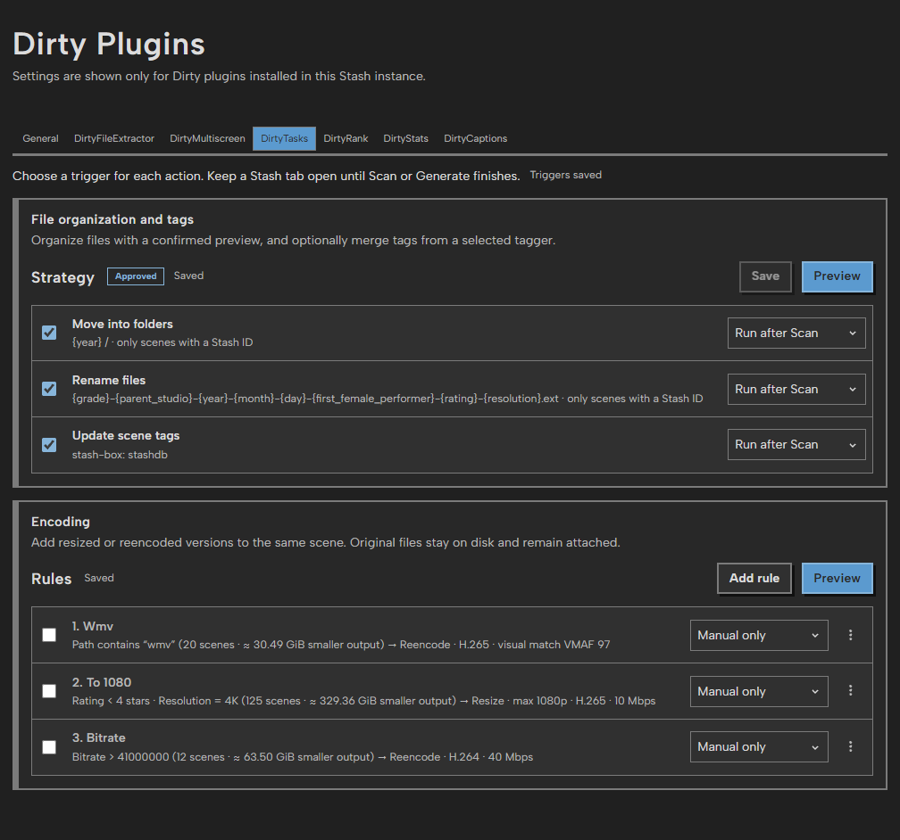

# DirtyTasks

DirtyTasks combines file organization, encoding, optional scene tag updates and
library backups.
It depends on DirtyPlugins, Python 3.9+, and (for encoding) FFmpeg/FFprobe.
Open **Dirty Plugins → DirtyTasks**.

## Action triggers

Move into folders, Rename files, Update scene tags, each encoding rule and
Back up library data have an independent **Manual only**, **Run after Scan**,
**Run after Generate** or **Run on a schedule** selector. Triggers autosave. A
Stash tab must remain open to observe successful job completion; queued work
continues without the browser. Changing a trigger does not launch work. Manual
Preview/Run, Refresh tags now and Back up now remain available.

## Schedules

**Run on a schedule** shows a time and weekday buttons; it starts every day at
03:00. Times are the Stash server's local time. A schedule keeps its time and
days while its action uses another trigger.

An open Stash tab runs a scheduled action at its time, through the same queued
tasks as Scan and Generate automation. If no tab was open then, the next page
load shows **Missed scheduled tasks**: run the selected ones now or skip them
until their next time. Closing the card asks again on the next page load. Each
action offers only its latest missed time, and each time runs or is skipped
once, whichever tab answers. A new or changed schedule starts from the moment
it is saved, so its earlier times never count as missed. Disabled actions and
rules are not scheduled. Documentation captures (`?docsCapture=1`) never show
the card.

Move and Rename run only their scheduled action, using the approved file
strategy. For example, Scan can move files and Generate can rename them. Tag
updates use their own trigger and do not need file-organization approval.
Queued work rechecks its trigger before starting. Deferred Scan, Generate and
scheduled work are retained separately; waiting scheduled slots add up to one run.

On upgrade from the shared running strategy, its selection is copied to every
existing action and encoding rule. Templates, approvals, rule order and enabled
states are preserved. New and duplicated encoding rules start with Manual.

## File organization and tags

Folder and filename strategies retain explicit Save and Preview/Confirm/Run.
Manual runs apply only the immutable confirmed preview. Automation applies the
approved strategy after a successful Scan or Generate observed by an open Stash
tab. Multiple files in a scene receive stable file-ID suffixes when renamed.

Optional tag updates merge tags from a selected configured stash-box source
using its selected trigger. Existing tags and other metadata stay intact. Successful checks
are cached for one day; Refresh tags now bypasses that cache.

An interrupted organization task shows a warning and **Recover organization
task** button only when its saved reservation remains and Stash has no active
organization job. Recovery releases the abandoned reservation and resumes
waiting tasks; it does not undo file operations. The warning stays hidden
while tasks are running, queued, or stopping. Its status refreshes when this
page opens, organization jobs change, and the Stash tab regains focus.

## Encoding

Ordered rules choose scenes through native Stash filters and either resize or
reencode them. The first enabled matching rule wins, for both manual and automatic evaluations.
If that rule uses a different trigger, the scene is skipped instead of falling
through to a later rule. Rules autosave; new rules are disabled.
Quality presets, visual-quality measurement, custom bitrate, codec, hardware
encoder detection/CPU fallback and container preservation remain available.
MP4/M4V files with a single continuous embedded timecode track are supported;
MOV timecode tracks are copied. The output must preserve the timecode, video,
audio and subtitles. Unknown data tracks and timecode layouts that cannot be
preserved remain blocked, even when the source file exists.
**View scenes** beside the filter selector opens the matching scene list in a
new tab, with the selected filters applied. **All scenes** opens the unfiltered list.

Preview and confirm a manual run. Each validated output is saved beside its
source with a distinct name, scanned, and attached to the **same scene**.
Both files remain on disk and attached. The original remains the primary file
until you choose otherwise in the finished job's details.
Results compare each new file with its original (**Created a 40% smaller
file**); both files stay on disk, so no space is reclaimed. Outputs must pass stream, dimensions, duration,
size and decode validation before publication. Generated versions are skipped
by later encoding runs, and the same original/settings combination is not
encoded again while its output remains attached.
Validation shows progress through the full decode. Content checks show progress
through the file's bytes, and indexing/attachment have their own activity labels.

Finished job details offer **Make all new files primary** and **Delete all old
files…**, covering successful encodes across every page of that job. Making
primary skips scenes where a new file is already primary. If several originals
were encoded in one scene, it prefers the current primary's new version;
each scene can have only one primary.
Both buttons are disabled when no eligible files remain, or availability cannot
be checked. Availability refreshes from current scene attachments, primary choices,
file presence and size, and shared-file ownership across the whole job.
Polling does not reread full media contents; deletion still performs its full content checks.

Deletion asks for confirmation, checks each original and replacement against
their recorded content, and skips shared, changed or missing files. It makes
the replacement primary first when needed, then removes the original through
Stash, respecting Stash's trash setting. Other scene files and metadata stay
intact. Both actions run in Stash's task queue and report changed, skipped and
failed counts. Use **Recover interrupted file action** in the details' file
action menu if its Stash task stopped before finishing.

Pause stops the encoder at once and discards its unfinished temporary output;
Resume revalidates and encodes that file again, then continues with the rest.
While paused, the run releases its file reservation so organization can run.
Cancel stops the encoder and cleans its unfinished temporary output. Once an
output is published, attachment finishes before cancellation. An interrupted
publication or failed attachment keeps the output and offers Retry recovery;
recovery never replaces or deletes the original. File organization and encoding
reserve file work through shared SQLite so they cannot run concurrently.
A run that no Stash task is running any more, for example after Stash
restarted, does not hold the files: organization pauses it and goes ahead, and
Pause or Cancel on it takes effect at once. Resume it later from Encoding. Only
a run with an encoded file still waiting to be attached keeps the files until
its recovery. When organization has to wait, the Stash log says so, and it runs
once the other task finishes.
Internal refresh scans do not trigger another automation cycle.

## Backup

The **Backup** section's **Back up now**, its trigger, and **Settings → Tasks →
Plugin Tasks → Back up library data** all write one
`dirty-backup-YYYYMMDD_HHMMSS.zip`. It goes to the **Backup folder** chosen
with **Browse…**, or, after **Use Stash's folder**, to Stash's backup folder
(the database's folder unless **Backup directory path** is set). It holds:

- the Stash database (`stash-go.sqlite`), copied through SQLite while Stash runs;
- blobs (covers and images), when Stash stores them on the filesystem;
- `config.yml` and any `custom.css`, `custom.js` and `custom-locales.json`;
- the scrapers folder, without Python caches;
- DirtyPlugins' `dirty_plugins.sqlite3` (all plugin settings, DirtyRank
  ratings and battles, caption index and task journals);
- `backup.json`, which lists where each part came from.

Every part except the Stash database can be turned off. **Keep newest
backups** deletes older `dirty-backup-…` zips in that folder after a successful
backup; 0 keeps them all, and other files are never touched. Settings
autosave; the section shows the last backup and a failed attempt after it.

Generated files, the cache and installed plugins are left out: Generate and the
package sources recreate them. `config.yml` contains Stash's API key, password
hash and stash-box keys, so keep backups private. The task checks free space
first, writes to a `.partial` file and removes it if anything fails.

To restore, stop Stash, then put each part back where `backup.json` says. Delete
any `-wal` and `-shm` files next to a database you replace, then start Stash.

## Upgrade from DirtyTidy / DirtyCompactor

1. Finish or cancel old workers. Resolve interrupted replacements with the old
   Compactor first; keep all recorded original backups until recovery succeeds.
2. Disable DirtyTidy and DirtyCompactor, install DirtyTasks and the updated
   DirtyPlugins hub (1.0.6 or newer), and reload plugins.
3. Hard-refresh Stash (Ctrl+F5) and open DirtyTasks. The one-time migration imports
   both settings sections, removes Delete rules, discards pending trial review
   outputs, and imports the running strategy. Its summary stays at the top of the
   panel until you close it. Review a fresh preview before running.
4. Choose the trigger for each action. Remove the disabled old plugin
   installations only after migration succeeds.

Historical records and tag checks stay in DirtyPlugins' shared SQLite database.
Migration does not launch any work. Organization automation needs a new approval because multi-file naming now
keeps each version distinct. Encoding uses a
new journal namespace so old replacement jobs cannot resume as additive jobs.

## Development

Run `npm ci` and `npm test`. Install only `.build/plugins/DirtyTasks/` into
Stash's `plugins/dirtyTasks/`, alongside the staged DirtyPlugins hub. The single
Python protocol entry is `dirty_tasks.py`; organization and encoding remain
independent internal modules. Metadata comes from `schemas/dirtyTasks.settings.json`.
All transport, shared UI, capture masking, autosave and navigation protection
use DirtyPlugins. Runtime data and temporary media are excluded from packages.

Use isolated Stash fixtures with synthetic media for attachment/recovery checks.
`?docsCapture=1` masks private paths and media in the interface.

## License

MIT; see [LICENSE](LICENSE). FFmpeg is provided by the host and is not bundled.
